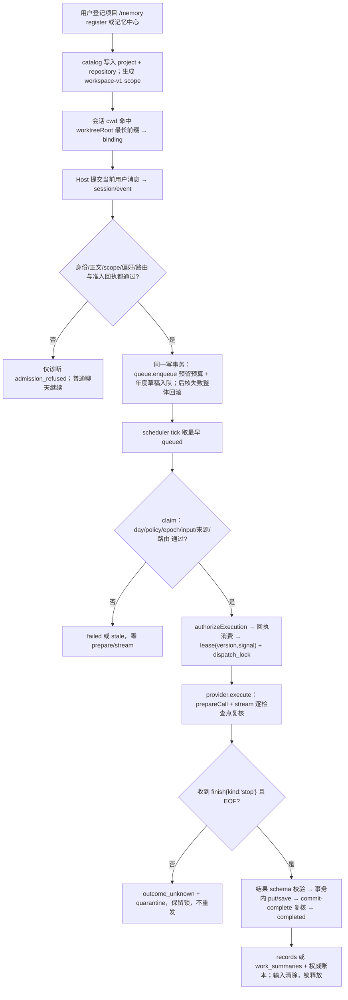
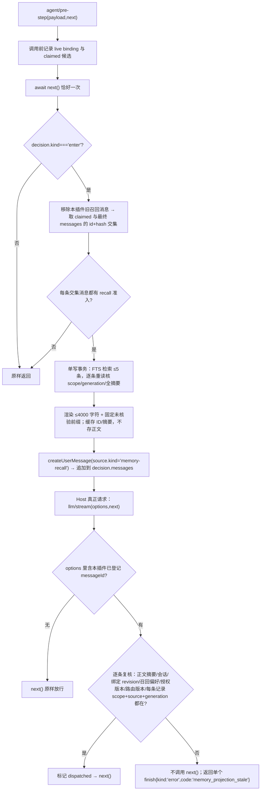
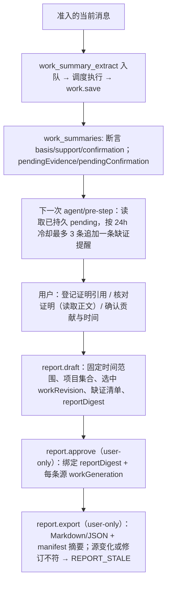

# 05 本地长期记忆插件完整机制说明

版本 `MEM-MECH-5`，日期 2026-11-09。对象：`dsh-local-memory-linqu` 0.4.0（进行中；M1为0.2.0基线，M2为0.3.0增量，v0.4.0为体验/后台增量），Host 基线 DeepSeek Harness 0.2.1-rc.5，build `d4db512a969fccf0c5cc7ec8fe38e9c1d27af916`。

本文是[机制说明合同](../../docs/mechanism-document-contract.md)要求的完成交付物，用途是**后续改进 skill 的依据**：说明实际触发、判断规则、工具/状态变化、证据、失败恢复，以及哪些是 skill 可调策略、哪些是 plugin/Host 必须执行的硬边界。历史阶段说明（[Task 2](task2-mechanisms.md)、[Task 3 hooks](task3-hooks-mechanisms.md)、[Task 3 execution](task3-execution-mechanisms.md)、[流接口修复](stream-contract-fix.md)）保留原编号与结论，本文汇总 M1 基线并补充 M2（v0.3.0）增量，不改写历史证据。

## 0. 阅读约定

- **编号**：`MEM-*` 只用于文档关联，不新增后台服务或配置项。历史编号沿用其首次定义含义（`MEM-QUEUE-01..04`、`MEM-LIFE-01..02`、`MEM-WORK-01..05`、`MEM-ADMIT-01..03`、`MEM-RECALL-01..02`、`MEM-HOOK-LIFE-01`、`MEM-HOOK-WINDOW-01`、`MEM-EXEC-01..05`、`MEM-STREAM-01`）。M1 新增编号为 `MEM-SCOPE-01`、`MEM-PROJ-01..03`、`MEM-GRANT-01..02`、`MEM-SCHED-01..03`、`MEM-BRIDGE-01..02`、`MEM-FINAL-01..03`、`MEM-CORPUS-01`、`MEM-REMIND-01`、`MEM-REPORT-01`、`MEM-MGMT-01..02`、`MEM-CAT-01`、`MEM-DATA-01`、`MEM-UI-01`、`MEM-INSTALL-01`。
- **实现状态标记**：【已实现】代码存在且有运行证据；【已实现·弱证据】代码存在但只有组件或夹具级证据；【设计未实现】设计合同或待办要求、代码不存在；【未验证】代码存在但没有运行证据。
- **路径**：除特别注明外均相对 `E:\dsh\plugin\05-local-memory`。行号引用是写作时的位置，不随代码演进保证。
- **不声称**：本文不声称完整 05 产品验收。M2 已交付 abstract/共享/适用性子集（v0.3.0），但 **MEM-204（能力事件代次消费）仍未实现**；M3（非 C 冷档）、`MEM-405`（年终维度模板）、M5 的更新/迁移与完整卸载旅程仍为**设计未实现**；真实业务 Provider、完整 GUI 视觉与 OS 级出口仍未验证。

---

## 1. 能力与分层

### 1.1 实际服务的用户场景

开发者先把自己的研发项目（一个逻辑项目可含多个仓库）登记到"记忆中心"，之后在该仓库工作目录下继续用 Harness 聊天：

1. 当前这条**已提交**的用户消息被允许提炼时，后台排队用**已批准的 Provider 路由**提炼成"经验记忆"，明确标为模型生成、未核验，并保留来源引用。
2. 同一项目后续提问时，按当前问题做**本地词法检索**，把命中条目的有界摘录注入本轮请求，并在真正调用模型前**再核一次**适用性；不适用就不发送。
3. 经验记忆可手动搜索、纠正、归档、恢复、明确删除；项目可退休，记忆保留。
4. 另设**年度工作记录**分区：从同一对话形成项目/需求/问题探索的粗粒度草稿，记录本人贡献、过程/结论、结果、时间精度、证明状态；缺证明/待确认在后续聊天里提醒一次；用户可登记/核对证明、确认贡献与时间；最终生成报告草稿，由用户审定后本地导出 Markdown/JSON。
5. 未登记项目时记忆功能暂停，普通聊天继续；用户可在聊天或记忆中心登记后重新生效。

### 1.2 分层职责

| 层 | 实际承担 | 关键代码/接缝 | 明确不承担 |
|---|---|---|---|
| Host plugin | 配置校验、项目目录、事件监听、准入/授权、调度、Provider 桥接、最终请求门、工具/命令/HTTP 注册、生命周期 | [plugin/index.mjs](../plugin/index.mjs) `apply(ctx, config)`；`inject` 声明 `llm, tools, commands, webServer, sessions, agents, approval` | 不处理 API key，不创建聊天 Agent，不扫描历史会话，不复制 Host 源码 |
| Client bundle | 设置页"记忆中心"：经验记忆、年度工作记录、处理任务三个标签；同源 HTTP 调用；5 秒可见时分页轮询 | [client.js](../client.js)：`settings.section` 注册 `id:'local-memory'`、`order:10`；`fetch('/dsh-local-memory/api')`；`POLL_MS=5000` | 不直连数据库、不读其他插件 DOM、不自带颜色体系（只用 `--dsw-alias-*`） |
| 本地 SQLite 数据根 | 项目目录、偏好、提醒状态、报告修订、经验正文/FTS、权威账本、预算、任务 | `src/projects.mjs`（catalog）、`src/backend.mjs`（store）、`src/store-internals.mjs`（authority） | 不是原始会话仓库；不同步远端；不存凭据 |
| Host 服务 | 模型调用与路由、工具/命令/网页路由注册、活会话/活 Agent 身份、用户审批、事件分发与 fiber 清理 | `ctx.llm.prepareCall`/`listProviders`、`llm/stream`、`session/event`、`agent/pre-step`、`tools.register`、`commands.register`、`webServer.register`/`getOrigin`、`sessions.get`、`agents.get`、`approval.request`、`ctx.effect` | Host 决定权限与网络；插件只能通过已声明服务访问 |
| skill / agent 策略 | 何时建议提炼或手动记住、如何解释拒绝与降级、何时提醒用户补证明、如何呈现未核验与来源、建议用户核对或重新登记 | 对话行为与说明文本；不在代码里强制 | 不能生成准入回执/执行许可、不能改 scope/路由/预算上限、不能替用户确认、不能把未验证提升为事实 |
| 操作系统 | 文件系统与固定卷、SQLite 原子提交、进程生命周期 | `node:sqlite`、`node:fs`；卷准入见 `MEM-DATA-01` | 不提供 SSD 介质擦除、不保证备份/远端副本被撤回 |

### 1.3 凭据、数据与生命周期归属

- **凭据归 Host 与用户**：插件不读取、不转存、不日志化任何 key。全部模型访问经 `ctx.llm`（宿主已配置 Provider），且请求必须匹配配置里批准的路由描述符（`MEM-BRIDGE-02`）。`plugin/`、`src/` 中对 `node:http|https|net|dns`、`fetch(`、`WebSocket` 的检索结果为空（本机 grep 核对），说明本版插件代码不自行联网；这不等于对宿主、子进程或 Chromium 的出口保证。
- **数据归用户本地**：默认根为 `dataRoot/<profile>`，`dataRoot` 默认为 `E:/dsh-data/05-local-memory`，`profile` 取配置或 `DSH_PROFILE`，否则 `default`。布局：

  ```
  <root>/catalog.sqlite              项目、偏好、提醒状态、报告与修订、操作幂等表
  <root>/catalog.identity.json       catalog 身份锚（与 catalog 绑定）
  <root>/hot/scopes/<digest(scope)>/ authority.sqlite + scope-<digest>.sqlite + authority.identity.json
  <root>/reports/<reportId>/         本地报告导出（或配置的 exportRootRef）
  ```

  `cold/`、`staging/` 在本版**不创建**，`catalog.sqlite` 也不建这两类目录；`status.cold` 显式返回 `{status:'not_configured'}`（实现与设计差异见 §7）。
- **生命周期归 Cordis fiber**：所有监听器、定时器、路由、工具、命令都用 `ctx.effect` 绑定；`ctx.root` 上的 `WeakMap` owner 阻止同一 Host root 重复安装；`dispose()` 幂等，按 hooks → reminders → projection → scheduler → grants → provider → registry 顺序清理。**数据不随停用/卸载删除**：代码中不存在删除 `dataRoot` 的路径（`MEM-INSTALL-01`）。

### 1.4 两个记忆分区：经验记忆与年度工作记录

| 维度 | 经验记忆（memories） | 年度工作记录（work_summaries） |
|---|---|---|
| 触发 | `session/event` 当前用户消息准入后自动入队 `memory_extract`；或用户要求后 `memory_remember`/`/memory remember` | 同一准入消息另入队 `work_summary_extract`（受 `workSummary.enabled` 控制） |
| 写入者 | 模型提炼（origin `model`）或用户显式（origin `user`） | 模型草稿（origin `model`）+ 用户纠正/合并/确认 |
| 集合/索引 | `records` + `ledger.entries` + FTS `memory_fts` | `work_summaries` + `ledger.entries`，**不进 FTS** |
| 自动召回 | 是：`agent/pre-step` 注入，经 `llm/stream` 最终门 | **否**：自动经验召回只查 memories；跨集合混入被 `MEM-RECALL-01` 禁止 |
| 可信度 | 视图恒 `verification:'unverified'` | 每条断言分 `basis`（inferred/user_reported）、`support`（missing/unread/supported/partial/conflicting）、`confirmation`（pending/user_confirmed） |
| 删除/保留 | `archive` 可恢复；`delete` 即清除 | 同左（共用生命周期）；报告与导出不复活历史 |
| 用户产物 | 记忆中心列表/详情 | 缺证提醒 → 报告草稿 → 用户审定 → 本地 Markdown/JSON |

两区共用同一 scope、store、epoch 与单 writer 事务，但 collection 分离：经验的删除/纠正不会修改年度记录，年度 merge 也不改变经验库。同一条对话消息可以同时产生两类 job（两个 purpose、两个 requestId），互不覆盖。

---

## 2. 端到端机制图

以下旅程都可复现：旅程 1–3 与 5 由 `tests/plugin-entry.test.mjs` 的闭环夹具加上 `tests/scheduler.test.mjs`、`tests/jobs.test.mjs`、`tests/lifecycle.test.mjs` 的分支用例组合覆盖；旅程 4 有 `tests/reports.test.mjs`、`tests/work-management.test.mjs`、`tests/proof-reminders.test.mjs` 的组件证据；旅程 2 的最终门另有真实安装库探针（§6.1）。

### 2.1 旅程 1：登记 → 会话准入 → 提取 job → 调度 → 批准路由派发 → 持久化



关键点与证据：

1. **登记**：`/memory register <名称>` 用当前会话 `cwd` 作为仓库根（用户手势），或记忆中心 `project.register` 显式给 `{name, repositories[]}`。`src/projects.mjs` 计算 `projectId = project-<sha256(name)>`，写 `projects`/`repositories`，`scope_ref` 唯一；`plugin/project-registry.mjs` 用 `createScope` 生成 `workspace-v1:` 摘要并刷新内存绑定（`rebuild()` 同时清 cwd 缓存）。
2. **绑定**：`bindingForSession` 用 `realpath(cwd)` 在 active 项目中取 `worktreeRoot` 最长前缀；未命中即未绑定。
3. **准入**：`session/event` 的 `user/message` + `surfaceOp:'append'`；`eventAt(seq)===event`、`agent.id===session.id`、`agent.session===session` 必须成立；正文 1–16 个纯文本块、合并 ≤8000 UTF-16；`source` 只允许 `kind/rpcId/clientTimeZone/principal`；`checkedText` 拒绝控制字符与秘密样式。通过后 `grants.admitMessage` 记回执（`MEM-ADMIT-01`、`MEM-GRANT-01`）。
4. **入队**：`queue.enqueue` 在**同一个** store 写事务内完成：冻结 scope/session/route/epoch/来源，校验日/会话预算，写 `ledger.jobs` + `job_inputs`；后核失败抛出事务外，预算、输入、job 全部回滚（`MEM-ADMIT-03`）。同一事务里 `onMessageAdmitted` 再把年度草稿入队（若 `workSummary.enabled`）。
5. **调度**：`plugin/scheduler.mjs` 每 `pollMs`（默认 1000）枚举 scope（上限 256），跳过 busy scope，取 `pending({limit:1})` 最老者，`runJob(jobId,{timeoutMs,signal})`；全局在途数受 `concurrency`（默认 1）限制。
6. **claim**：`src/jobs.mjs` 在写事务里检查 state、该 scope 的 `dispatch_lock`、日/策略、epoch、输入存在且指纹一致、输入计量未变、来源未被阻断、路由仍批准；然后 `executionLease` → `authorizeExecution(phase:'claim')` 消费回执（`MEM-GRANT-01`），写 `running` + `dispatch_lock(phase='in_flight')`，返回 `{row,payload,route,token,lease}`。
7. **派发**：`plugin/harness-provider.mjs` 复核路由描述符与已注册 Provider 唯一性、计量 `prompt+input ≤ 8000`、每个检查点调 `assertExecution`（回到 queue 写事务复运行状态/epoch/来源/路由/lease），拼 system+user 消息后 `llm.prepareCall`，再逐 chunk 校验（`MEM-BRIDGE-01`）。
8. **持久化**：结果必须是 `{"schema_version":1,"memories":[{"text","kind"}]}`（≤5 条）或 `{"schema_version":1,"summary":{...}}`；`store.put(..., {expectedGeneration: epoch})` 或 `work.save/merge`；随后 `checkRunning('commit-complete')` 再核一次，最后 `finish('completed')` 清输入、删锁。

**分支**：无回执/错 scope/错 inputDigest/路由变化 → `failed` + `reason='execution_authorization_unavailable'`，`cost=not_dispatched`，零 `prepare`/零 stream；预算日或策略变化 → `failed budget_day_or_policy_changed`；epoch 变化或来源被阻断 → `stale`；路由撤销 → `failed route_unavailable`；超时/取消/provider 异常 → `outcome_unknown` + quarantine + 保留锁；完整响应但 schema 非法 → `failed invalid_model_result`（保留费用标记，无成果）；提交后许可失效 → `stale` 并回滚成果。

### 2.2 旅程 2：召回 → pre-step 注入 → `llm/stream` 最终门 → 派发或阻断



关键点：pre-step 只保证"交还 decision 那一刻有效"（历史 `MEM-HOOK-WINDOW-01` 的缺口），真正的关闭点是 `llm/stream`（`MEM-FINAL-01`）。本轮及此前注入过、且仍在会话历史里的召回消息，会在**每一次**含它的请求上被重新复核；任何一条记录被删除、归档、来源变更、项目退休、召回开关关闭、授权版本变化或路由变化，都整条阻断该请求（`tests/final-projection.test.mjs` 21 项，真实探针 3/3）。只有完全不含本插件 own 消息的普通请求才原样放行；含 own 消息但无登记投影的请求同样 fail-closed（`MEM-FINAL-02/03`）。

### 2.3 旅程 3：显式删除/归档/纠正，以及重启与晚到结果

1. **删除**（`memory.delete`，user-only）：`boundScopes` 定位记录（active 用 `store.get`，archived 用权威账本+正文摘要）→ 校验 `expectedGeneration===store.generation()` → `store.forget`：`advance({lifecycle:true})` 递增 epoch、`blockSources` 写来源阻断、账本置 `deleted`、`DELETE FROM records`、删除所有非当前 epoch 的持久 job 输入。返回 `irreversible:true`、`currentSqliteBodyAndIndexCleared:true`、`backupCopies:'not-revoked'`、`remoteModelData:'not_revoked'`。
2. **归档/恢复**：`archive` 保留正文并置 `archived`（退出召回）；`restoreArchived` 要求仍为 archived、来源未被阻断、正文 generation 与摘要一致，再递增 epoch 置回 active。
3. **纠正**：`memory.correct` 用旧记录的 `sourceRef` 与新 `sourceVersion` 生成**新 id**，旧记录置 `superseded` 并删除正文，新记录 `supersedes=旧id`；`sourceVersion` 必须与旧值不同。
4. **排队任务的联动**：生命周期递增 epoch 会把旧 epoch 的 `queued` 直接置 `stale` 并删输入（`src/store-internals.mjs` `advance`），在途任务在提交前复核 epoch/来源失败后转 `stale`。
5. **重启**：`scheduler.start()` 在 `recoverOnStart` 时对每个 scope 调 `queue.recoverInterrupted()`：`running` → `outcome_unknown`（`reason='worker_interrupted'`，quarantine），清持久输入，**保留 dispatch_lock**；不重发。
6. **晚到结果**：`runJob` 的提交路径只接受"仍是 running 且 run_token 相同"的行；晚到的 success 只返回当前视图、不写成果；`outcome_unknown` 的锁只能由用户确认（`task.confirmRemoteQuiescence`/`recovery.confirm` → `MEM-GRANT-02`）后释放，原 job 仍 unknown。

### 2.4 旅程 4：年度草稿 → 缺证提醒 → 报告草稿 → 用户审定 → 本地导出



细节与证据：

- **草稿**：`queue.enqueue` purpose `work_summary_extract`（requestId `work-v1:<fingerprint>`），模型输出经 `validateWorkDraft`；`work.save` 生成 `work-<sha256(scope+itemRef)>`，断言 `basis:'inferred'`、`support:'missing'`、`confirmation:'pending'`，时间精度通常是 `unknown`，并计算 `pendingEvidence`（非 unknown 且未 supported 的断言）与 `pendingConfirmation`（未 user_confirmed 的断言 + 时间 + 冲突项）。
- **缺证提醒**：`plugin/proof-reminders.mjs` 注册**另一个** `agent/pre-step` 监听器，先 `await next()`，只在 `enter` 且信号未 abort、绑定项目 active、全局与项目提醒都开启时工作；只读**已持久**的 pending 状态（不读证明文件、不做重新授权），逐 (scopeRef, recordId, claimRef) 判 `reminderDue`（never_shown / generation_changed / cooldown_elapsed），最多 3 条记录拼一条 ≤480 字消息，`source.kind='memory-proof-reminder'`，然后 `markShown`（now+cooldown）。失败只记诊断，绝不改变主请求。
- **报告**：`src/reports.mjs` `draft` 校验时间范围精度（year/month/day，且首尾不反向），逐项目要求 active，枚举 `work.list({limit:500})`（超限 `REPORT_TOO_LARGE`），按时间区间分类 `in_range`/`partial_overlap`/`outside`/`unknown`；产物含 `items`、`pendingProofs`、`pendingConfirmations`、`unknownTimeItems`、`outOfRangeCount`、`sourceRevisions`、`dimensionMapping:{status:'pending_reference'}`，`contentDigest` 决定 `reportId`。
- **审定**：`approve` 要求 actor `user`，比对 `reportDigest` 与规范化排序后的 `sourceRevisions`，并用 `currentSources()` 重算每条 work 的当前 generation；不匹配即 `REPORT_STALE`。通过后写 `approval{reportDigest, sourceRevisions, approvedAt, actor}` 与 `approvalDigest`，`revision+1`、`state='approved'`。
- **导出**：`export` 要求 actor `user`、`revision` 与当前行一致、`format ∈ {markdown,json}`、`outputRootRef` 必须等于已批准导出根（默认 `reports`）；state 为 stale 直接 `REPORT_STALE`；approved 时重算 `approvalDigest` 并重核源 generation，任一不符即把报告置 `stale` 并抛 `REPORT_STALE`。文件名 `<reportId>-r<revision>-<state>.<ext>`，写入 `<exportRoot>/<reportId>/`，manifest 记录 `manifestDigest`、`completeness`、`localPathsIncluded`。Markdown 明确写入"草稿/已审定"、逐断言 basis/support/confirmation、待补证明与待确认清单、未知日期清单，并声明维度映射为 `pending_reference`。
- **断模型仍可导出**：导出只读 catalog 与本地文件，不调用 Provider。

### 2.5 旅程 5：安装 / 停用 / 卸载

- **安装**：profile `package.json` 的 `dsh.profile.bundles` 增加 `dsh-local-memory-linqu`，`node_modules/dsh-local-memory-linqu` 链接到本目录；包声明 `dsh.bundle.patch=./cordis.patch.yml`、`dsh.client={platform:'web',immediately:true}`、`dsh.compatibility.dshReleases['0.2.1-rc.5+']='compatible'`。`cordis.patch.yml` 插入 `{id:'dsh-local-memory-linqu', name:'dsh-local-memory-linqu', config:{}}`。
- **激活**：`apply` 顺序为 normalizeConfig → registry.initialize → provider bridge → grants → reports/work ops → management + HTTP → finalProjection → scheduler → session hooks → tools → `/memory` 命令 → HTTP 路由 → `projection.install` → `scheduler.start` → 缺证提醒。任何一步失败走 `registerStatusSurface('activation_failed')`：只留一个返回错误的 `memory_status` 工具和固定报错的 HTTP 路由，状态 `degraded`，不抛穿事件循环。配置非法时同理（`invalid_config`），不注册任何记忆工具/监听器。
- **停用/卸载**：fiber 清理触发 `dispose`：hooks 停监听并 drain（≤100ms，保留已持久 queued 输入，返回 `queuedInputs:'retained_by_queue'`）→ reminders → projection（移除 `llm/stream` 监听器）→ `scheduler.stop()`（abort 在途 run，最多等 1000ms，`remoteStopConfirmed:false`）→ `grants.revoke()`（状态 revoked、abort 全部 lease、清回执）→ provider dispose（最多等 100ms 清理）→ `registry.close()`（关 store 与 catalog）。owner 表删除后可在同一 root 重新 `apply`（`plugin-entry` 测试覆盖）。**数据根、catalog、store、已导出报告都保留**。

### 2.6 横切分支：取消、部分完成、未知与恢复

| 情形 | 实际行为 | 不承诺 |
|---|---|---|
| 用户消息被拒（未绑定/伪造/含秘密/异步回调） | 只记 `admission_refused` 等固定诊断码，Host 原消息照常提交 | 不给聊天内提示；不"教育"用户 |
| 入队后授权被撤 | `failed` + `execution_authorization_unavailable`，零派发，预算不退 | 不自动补发；不重试旧 job |
| 派发前超时/取消 | `failed`（`cancelled_before_dispatch` 等），`cost=not_dispatched` | 不证明远端未收到（未触碰 prepare 时才有本地自证） |
| 派发中取消/超时/异常 | `outcome_unknown` + quarantine，保留锁；晚到结果不写 | 不声称远端已停止 |
| 完整响应但提交时许可/来源变化 | `stale`，成果回滚，费用保留 reported/unknown | 不把 stale 当失败掩盖 |
| 进程重启 | `running` → `outcome_unknown`，清输入，锁保留 | 不靠重启解闸 |
| 用户确认远端结束 | 释放 dispatch_lock，原 job 仍 unknown，不重试 | 确认来自用户，不来自模型 |
| 插件停用 | 撤销 lease、停调度、撤注入监听器 | 不撤回模型已接收内容，不删除本地数据 |
| 召回记录在会话中途被删 | 该请求被最终门阻断（单 chunk error） | 无法从已提交历史中撤回那条召回正文 |

---

## 3. 稳定机制编号规则表

表格列按合同要求：机制编号、场景/触发、输入与前置条件、判断及理由、工具/状态变化、输出/证据、异常/用户提醒、可由 skill 改什么、硬边界及验证。每张表头相同，按域分组。

### 3.1 绑定、准入与执行授权

| 机制编号 | 场景/触发 | 输入与前置条件 | 判断及理由 | 工具/状态变化 | 输出/证据 | 异常/用户提醒 | 可由skill改什么 | 硬边界及验证 |
|---|---|---|---|---|---|---|---|---|
| MEM-SCOPE-01 | 登记仓库、绑定会话、开 store 前 | `canonicalRoot`、`worktreeRoot`、`revision`、`buildVariant` | `realpath` + 小写（win）+ 目录校验后取 `sha256(JSON)`，得 `workspace-v1:<64hex>`；revision/buildVariant 变化即新 scope（新空库，不迁移） | `createScope`；`repositories.scope_ref UNIQUE` | scope 字符串；每 scope 一个 store | 路径非绝对/非 C:E:H 固定盘/含符号链接/非目录 → 拒绝；`SCOPE_CONFLICT` | 只能建议用户核对登记参数；不能自报 scope | 调用方不能传 scope，scope 只由目录与登记状态算出（`src/scope.mjs`、`src/projects.mjs`、`tests/projects.test.mjs`、`tests/project-registry.test.mjs`） |
| MEM-PROJ-01 | 每个 `session/event` 与 `agent/pre-step` | `session.header.cwd` + 已登记 active 绑定 | 取 `worktreeRoot` **最长**前缀匹配；项目必须 active；无匹配即"未绑定" | `registry.bindingForSession`（带 cwd 缓存，rebuild 时清空） | 冻结 binding `{projectId,projectRevision,repoId,revision,buildVariant,scopeRef,bindingRevision}` | 未绑定：只记诊断，普通聊天继续；模型记忆工具返回 `UNBOUND`；不注入召回 | 可提示用户登记或 `/memory register`；不能把未绑定提升为全局 | 绑定只来自 catalog + 真实 cwd；`tests/project-registry.test.mjs`、`tests/plugin-entry.test.mjs`（unbound 用例） |
| MEM-PROJ-02 | 每次插件激活 `initialize()` | `config.projects`（≤64 项，每项 ≤16 仓库） | 同名同 binding 幂等；同名不同 binding → `CONFIG_CONFLICT`，记入 `degraded`、**不覆盖用户数据**；插件据此停用自动提炼/召回（`status.automaticDisabled='config_conflict'`），手动管理仍可用；不阻断插件激活本身 | `seedConfigProjects` → `catalog.registerProject(origin:'config')`；冲突时运行时禁用 extraction/recall/workSummary | `status().degraded[]` + `status.automaticDisabled` + 诊断 `config_project_<CODE>` | 单项目冲突降级并停止自动记忆 | 可建议改配置或改用用户登记 | 配置只读、用户数据优先；`tests/project-registry.test.mjs`、`tests/plugin-entry.test.mjs` config-conflict 用例 |
| MEM-PROJ-03 | 用户退休项目 | `projectId`、`expectedRevision`、`reason` | `state='retired'`，保留 repo 行、store 与记忆；不再参与 `bindingForSession`；报告要求 active | `catalog.retireProject`；`rebuild()` | 项目视图 + `memoryRetained:true`、`memoryDeleted:false` | `STALE_REVISION`；已退休再编辑 `PROJECT_RETIRED` | 解释"退休≠删除" | 无物理删除项目路径；`tests/project-registry.test.mjs`、`tests/management.test.mjs` |
| MEM-ADMIT-01 | 真实 `session/event` 的 `user/message` + `surfaceOp:'append'` | live `sessions.get`/`agents.get` 对象相同、`agent.id===session.id`、`session.eventAt(seq)===event`；正文 1–16 块 ≤8000 字符；`source` 仅 `kind/rpcId/clientTimeZone/principal` | 只接受当前用户纯文本消息；附件、未知块、秘密样式、混合非法材料整条拒绝；extract 与 recall **分别**授权 | `grants.admitMessage` 写回执；hook 只入队不派发 | 回执 `{originRef,contentHash,authorizationVersion}`；诊断码 | 拒绝只记诊断，不阻止 Host 提交、不发用户通知 | 可解释为什么需要批准、要求更小片段 | 模型/skill 不能用 source 标签替代许可；`tests/session-hooks.test.mjs`（25 项）、`tools/host-api/hooks.test.mjs`（8 项） |
| MEM-ADMIT-02 | 同一消息重放/编辑 | session header v4、id、createdAt；`requestId` 只绑定 sessionRef+消息 id+`memory_extract` | 同 id 同事件复用已有预算/job；同 id 改文或换 seq 保守冲突拒绝 | `requestId=hook-v1:<fingerprint>`；`sourceRef=<sessionRef>/event/<seq>/message/<digest>`；`sourceVersion=fingerprint({originRef,contentHash})` | 幂等回执；`queuedCount` 是成功入队回执次数，不是 job 数 | 冲突只记 `admission_refused` | 不得建议"换 requestId 重试"绕过去重 | 去重键不含原文/路由/epoch；`tests/session-hooks.test.mjs` 幂等用例 |
| MEM-ADMIT-03 | 事件内微任务入队 | 冻结 store/queue/scope/session/epoch/route/回执；最多 32 个 pending、累计 32000 字符、等待 >1000ms 丢弃 | 入队前证明 queue 属同一 store；外层 `write()` 事务内同步入队；事务前后各复核一次绑定与回执 | 后核失败抛出事务外 → job/job_inputs/日预算一起回滚 | 成功：`message_queued`；失败：`admission_refused` | 超限/超时只丢本次，不排队 | 不能建议提高 pending 上限（CAPS 固定 32/32000/1000） | 硬上限不可由配置或 prompt 放大；`tests/session-hooks.test.mjs` |
| MEM-GRANT-01 | `authorizeExecution(metadata)` 首次为某 job 取 lease | 冻结 metadata：phase/jobId/scopeRef/payloadFingerprint/purpose/sessionRef/sourceRef/sourceVersion/fragmentRef/inputClass/inputDigest/generation/route/itemRef | purpose 仅 `memory_extract`、`work_summary_extract`（自动）与 `work_summary_merge`（需用户确认）；phase ∈ claim/dispatch/commit/commit-complete；`sourceRef` 必须匹配 `.../event/N/message/<64hex>` 且 sessionRef 一致；回执须存在、action=extract、scope/session 匹配、24h 内、`authorizationVersion` 相同、`inputDigest` 相同、`fingerprint({originRef,contentHash})===sourceVersion`；同一 purpose 已消费必须消费给同一 leaseKey | `receipts`/`sources` Map（上限 2048）、`consumed: Map(purpose→leaseKey)`、`leases`（空闲 15min 清理） | 首次返回 `{authorizationVersion, signal}`；同 leaseKey 后续 phase 复用同一 signal | 任一不符 → throw → queue 写 `execution_authorization_unavailable`，`cost=not_dispatched`，零 prepare/stream；诊断 `execution_refused` | 只能解释"需要重新对话产生新消息"；不能生成回执 | 回执唯一创建入口是 `admitMessage`，工具/模型无入口；`tests/host-grants.test.mjs`（16 项）、`tests/execution-authorization.test.mjs`（13 项） |
| MEM-GRANT-02 | unknown 解闸与 `work_summary_merge` 执行前 | `noteUserConfirmation({action:'recovery.confirm',scopeRef,jobId,status})` 只由管理 API 的用户动作调用；`authorizeRecovery({action:'confirmRemoteQuiescence',scopeRef,jobId,status,confirmationRef})` 由 queue 调用 | 确认 TTL 2 分钟、一次性、scope/job/status 全等；否则 false | `confirmations` Map（上限 128）；消费即 `consumed=true` | `confirmationRef`；queue `released` | 过期/伪造/false → unknown 保持隔离，报 `TASK_STATE_CONFLICT`/`UNAUTHORIZED` | 可引导用户点"确认远端已结束"；不能代替确认 | 入口只在 `task.confirmRemoteQuiescence`/`recovery.confirm`（user-only）；queue 只认 `authorizeRecovery===true`；`tests/host-grants.test.mjs`、`tests/management.test.mjs` |
| MEM-EXEC-01 | 可信调用方显式 `runJob` | 冻结身份同上；输入正文不进入授权回调 | 默认拒绝：授权回调缺失/返回 Promise/返回 true 或缺字段/伪 prototype 一律拒绝；回执严格 `{authorizationVersion, signal}` 且 signal 验品牌 | queue 清持久输入、保留已预留预算 | 失败码 `execution_authorization_unavailable` | 只记码，不泄漏内部错误 | 可建议缩小片段或等待配置稳定 | 授权回调不得执行网络/读取无关材料（可信 Host 接口，非 JS 沙箱）；历史 [Task 3 execution](task3-execution-mechanisms.md)、`tests/execution-authorization.test.mjs` |
| MEM-EXEC-02 | 同一 job 的后续 phase | 同一 lease 的 version 与 signal 对象 | 版本漂移、signal 被替换或已 abort → 本次 lease 黏性失效，之后即使换新 grant 也不能继续旧运行 | 撤权时 `AbortController.abort()` 全部 lease；后续 phase 复用同一 signal | `lease.check(phase)` 通过则继续，否则本次运行失败 | 失败统一归为授权不可用，不区分原因 | skill 只能解释取消的实际边界 | 只改版本不能唤醒悬挂 prepare；`tests/host-grants.test.mjs` 撤权用例 |
| MEM-EXEC-03 | 覆盖 prepare 的异步窗口 | `assertExecution` 在各检查点调用 | 在 Provider invoke 前、prepare 前/后、stream 前、每次 next 前后、公开完成边界都复核 lease/run_token/epoch/来源/路由 | 桥接每个 checkpoint 回到 queue 写事务 | 失败 → `RouteUnavailable`（未触碰 prepare）或 unknown | 提醒用户"结果不明"而不是"失败" | 不能以 prompt 跳过 prepare 后的 guard | 只约束本项目 queue/桥接接缝，不证明 adapter 内部无重试；`tests/harness-provider.test.mjs`（26 项） |
| MEM-EXEC-04 | 完整响应后的提交 | 解析并校验 schema 后的成果 | 同一同步 `write` 内：复核 lease/worker token/原来源/epoch/路由 → 写 records 或 work_summaries → 再复核 → completed；年度 merge 先捕获 writtenEpoch 再后核 | 单事务提交；后核拒绝抛出事务外，另开事务写 `stale` 并清输入 | `completed` 或 `stale` | 呈现候选与证明缺口，要求用户复核 | 事务前后检查、schema、集合隔离不可绕 | 模型输出只能是未核验经验或工作草稿；`tests/jobs.test.mjs`（14 项）、`tests/execution-authorization.test.mjs` |
| MEM-EXEC-05 | 执行可能已开始后的 abort/timeout/非明确终结错误 | 已 dispatch | 一律 `outcome_unknown` + quarantine + 保留锁；晚到 success/reject 不提交、不放行第二个任务；只有可信恢复确认可解闸 | `dispatch_lock(phase='unknown')` 保留 | 终态表见 [Task 3 execution](task3-execution-mechanisms.md) | 提示"待核"，不提供盲目重试按钮 | 不能自动解除 unknown，不能重发旧 job | 预算不退；`tests/scheduler.test.mjs` unknown 用例、`tests/jobs.test.mjs` |

### 3.2 队列、调度、Provider 与最终请求门

| 机制编号 | 场景/触发 | 输入与前置条件 | 判断及理由 | 工具/状态变化 | 输出/证据 | 异常/用户提醒 | 可由skill改什么 | 硬边界及验证 |
|---|---|---|---|---|---|---|---|---|
| MEM-QUEUE-01 | 当前获准片段需要提炼 | scope、来源、已注册 routeRef、purpose、epoch、输入 ≤8000 | 入队冻结路由/用途/epoch/会话/输入摘要，并在事务内预留预算（日/会话/字符/输出 token，日界 Asia/Shanghai） | `ledger.jobs` + `job_inputs` + `daily_budget` + `session_budget` | job 视图；预算占用 | 预算耗尽 → 入队拒绝（hook 只记诊断） | 可选何时提炼、片段大小；不能扫描历史补材料 | 输入上限、credential 来源拒绝、模型不能选路径/scope；`tests/jobs.test.mjs` |
| MEM-QUEUE-02 | 一个排队任务准备执行 | 冻结 provider/model/routeVersion | 只用冻结路由；登记 scope 级 `dispatch_lock`；提交前再查路由与 epoch；默认并发 1（`scheduler.concurrency` 可配 1..4），互斥粒度是**每个 scope** 的锁 | `dispatch_lock` | `dispatch_gate_held` 时不动该 job | 说明"等待中/不可用" | 不能"借"另一路由或另一个 key | 跨 scope 的锁不能由别的 scope 解开；历史表述"全根并发 1"按当时单 scope 实现描述，当前应理解为每 scope 串行 + 全局上限（见 §7） |
| MEM-QUEUE-03 | 超时/取消/进程中断 | 已 dispatch 或已 claim | 超时/取消立即 unknown；崩溃保留 running+输入+锁，需显式 `recoverInterrupted` 才转 unknown 并清输入；预算不退 | `finish(...,'outcome_unknown',{quarantine:true})` | 终态 + 锁状态 | 提示"待核" | 停止该任务推理，建议核对授权 | 恢复不解闸；旧请求不重试；`tests/jobs.test.mjs`、`tests/scheduler.test.mjs` |
| MEM-QUEUE-04 | 明确完成的结构化结果 | `finishReason:'stop'` + 合法 schema | 校验长度/字段/秘密后同事务写成果并清输入；非法字段不伪装完成 | records 或 work_summaries + completed | 成果 id 列表 | 只报固定原因码 | 可解释缺字段与补录方式 | 输出不能改 scope/来源/support/confirmation；`tests/jobs.test.mjs` |
| MEM-SCHED-01 | 插件激活且 scheduler running | scope 列表（≤256）、`pollMs`、`concurrency` | tick 时先 `reconcileRevocations`（版本变→abort 在途），再按 scope 顺序取最早 `queued` 启动一个；busy scope 跳过；`launched` 全部 settle 后 tick 结束 | `setInterval`（`unref`）+ 首个微任务立即 tick；`busyScopes`/`inflight` | `scheduler.status()`：state/running/pendingScopes/lastTickAt/lastError | 单 scope 出错只记 `lastError` 和诊断，不崩调度 | 可解释排队顺序；不能改并发上限以外的语义 | 并发、超时、轮询都有 CAPS；`tests/scheduler.test.mjs`（9 项） |
| MEM-SCHED-02 | `start()` 且 `recoverOnStart` | 全部已登记 scope 的 queue | 对每个 scope 调 `recoverInterrupted()`：running→unknown、quarantine、清输入、留锁；同步要求（返回 Promise 即拒绝） | queue 状态迁移 | `{scopes,recovered}` | 恢复失败只记 `recovery_failed` | 可说明"重启不复活、不重发" | 恢复不解锁、不重试；`tests/scheduler.test.mjs` 恢复用例 |
| MEM-SCHED-03 | `stop()`/取消请求 | 在途 runs、timer | 清 timer、abort 每个 run、最多等 1000ms，返回 `remoteStopConfirmed:false`；从未重发 unknown | state=new→running→stopping→stopped | stop 回执 | 明确"只是本地停止" | 可解释取消边界 | queue **没有** `cancel` 方法 → 管理 API `task.cancel` 返回 `CANCEL_UNAVAILABLE`；`tests/management.test.mjs` "cancel is honestly unavailable" |
| MEM-BRIDGE-01 | `provider.execute` 桥接一次真实模型调用 | `{purpose,input,requestId,maxTokens,signal,assertExecution}` | 成功条件：chunk 结构合法、块索引/类型一致、≤32 块、≤8192 chunk、文本 ≤64000、恰好一个 `finish{kind:'stop'}`、拿到 EOF；prepare 返回的 provider/model/maxTokens 必须等于请求；usage 边界校验 | `llm.prepareCall` + `prepared.stream`；每个 chunk 前后 checkpoint | `{text, finishReason:'stop', usage?}` | 任何异常 → 抛 unknown；取消 → abort iterator 且 reject；`remoteStopConfirmed:false` | 不能把"结束无 finish"当成功；可解释"结果不明" | 显式完成才成功；`tests/harness-provider.test.mjs` |
| MEM-BRIDGE-02 | 每次绑定/复核路由 | `readApprovedRoute(routeRef)` 返回 `{routeRef,provider,model,routeVersion}` | 必须同步、字段完整、routeRef 相同；provider 必须在该 Host `listProviders()` 中唯一存在；每 route 记基线哈希，变化即 invalidate 并取消在途调用；`routeVersion=fingerprint({activation,approval})` | `baselines` Map（≤64）；监听 `llm/adapters-updated`、`loader/volatile-update`、`settings/document-updated`、`app-boot/config-reload` | 冻结描述符；`provider.status()` | 失效后 `RouteUnavailable`（未派发） | 可建议用户检查 Provider/配置 | 路由只能由用户 patch 提供（`routes`），模型不能选；`tests/configuration.test.mjs` 路由版本用例、`tests/harness-provider.test.mjs` |
| MEM-FINAL-01 | 每次 `llm/stream` 请求 | `options.sessionId`、`options.messages`（≤2000）与已登记 projection | 按 `sessionId+message.id` 找到本插件注入的消息；再逐条核：单 text 块摘要等于 `textDigest`、会话仍 live、scope 绑定仍 active 且 `projectRevision`/`bindingRevision` 未变、项目召回偏好为 true 且 `config.recall.enabled`、`authorizationVersion` 未变、路由 `routeVersion` 未变、每条记录 `store.get` 的 scope/source/sourceVersion/generation 全等；全部通过才 `next()` | projection 状态 pending→dispatched；失败置 invalidated | 通过：原样 `next()`；失败：不调用 `next()`，只产出单个 `finish{kind:'error',failure.code:'memory_projection_stale'}` | 诊断 `projection_stale`（带 reason）；用户看到该请求被拒 | 可解释为何被拒、建议开新会话；不能要求"忽略" | Host 深冻结请求不可改写，只能整条撤回自己的消息；`tests/final-projection.test.mjs`（20 项）、真实探针 3/3 |
| MEM-FINAL-02 | 请求里有本插件 source 的召回消息，但找不到已登记 projection | `options.sessionId`、`options.messages`、projection 映射 | 先按 `sessionId+message.id` 匹配；无任何匹配时再区分"普通请求"与"含本插件 own 消息但未登记"：普通请求→`not_ours` 原样 `next()`；含 own 消息但未登记（记录失败、投影被 1024 上限淘汰、插件重装后旧历史）→**fail-closed 阻断**，不把未复核的自家消息发给模型 | 只读映射；记录 `projection_unrecorded` 诊断 | 普通请求 `{action:'not_ours'}`；未登记 own 消息 → `block` 且只产出单个 `memory_projection_stale` finish | 用户看到该请求被拒，需开新会话 | 可解释"为什么被拒"；不能要求忽略 | 不能靠"看起来不是自己的"或元数据淘汰放行；`tests/final-projection.test.mjs` "unregistered own recall message fails closed" |
| MEM-FINAL-03 | session-hooks 准备注入召回消息 | `onRecallMessage` 回调与 projection 登记结果 | 注入前必须成功登记投影：回调抛错/异步/返回 false → 不注入该消息（主请求继续，无记忆内容）；避免出现"历史里有 own 消息但无投影"的必然阻断 | `projected=false` → 抛局部拒绝；仅诊断 `recall_projection_refused`，不产生 job | 本轮 `decision.messages` 不含召回消息；普通聊天照常 | 静默降级为无召回（诊断可见） | 不能绕过投影登记 | `tests/final-projection.test.mjs`（throwing/async/false 三例） |
| MEM-STREAM-01 | 任何改动 `llm/stream` 监听器 | Host `LlmRuntime.streamWithRegistration()` 直接把 waterfall 返回值交给 `yield*`/`for await` | 监听器必须**同步**返回 `AsyncIterable`；`async` 监听器会把 `next()` 包装成 Promise，导致 `stream is not async iterable` | 无状态；仅返回类型约束 | 回归：直接 `yield*` 消费普通请求与失效召回两条路径 | 修复前真实探针复现该错误 | skill 无可调阈值；改 prompt 不能让 Promise 变成可迭代流 | 硬接口合同，见[流接口修复](stream-contract-fix.md)、`evidence/stream-contract-before.tap` |
| MEM-HOOK-WINDOW-01 | pre-step 交还 decision 之后仍有 await | pre-step 的 live binding 与 recall 权限 | 历史缺口：交还 decision 后到 dispatch 之间，forget/撤权/切 scope 仍可能发生，session 事件不能否决已发生的 log.push | 由 `MEM-FINAL-01` 在 `llm/stream` 闭合 | 现在存在可证明的最终控制点（真实安装库 3/3） | 缺口未闭合时应降级为"只手动搜索" | 不能退回把 pre-step 当最终门 | 该编号保持历史含义：**门在 llm/stream，不在 pre-step**；探针 `evidence/m1-host-probe.json` |
| MEM-HOOK-LIFE-01 | 安装/重复安装/停用 | `ctx.root`、`ctx.on`、`ctx.effect` | 同 realm 全局 Symbol 下的 WeakMap 按 root 登记 owner token；重复安装抛错；局部注册失败逐项清理；dispose 幂等、只删自己 token | `owners` WeakMap；listener off 列表；drain ≤100ms | `status()`：pendingAdmissions/queuedCount/injectedCount/cacheEntries | 已持久 queued 输入保留，返回 `queuedInputs:'retained_by_queue'` | 可解释"停用不取消已排队" | 不证明跨 VM/进程互斥；`tests/session-hooks.test.mjs`、`tests/plugin-entry.test.mjs` dispose/reinstall 用例 |

### 3.3 记忆语料、召回与生命周期

| 机制编号 | 场景/触发 | 输入与前置条件 | 判断及理由 | 工具/状态变化 | 输出/证据 | 异常/用户提醒 | 可由skill改什么 | 硬边界及验证 |
|---|---|---|---|---|---|---|---|---|
| MEM-CORPUS-01 | 写入/读取单条经验 | `{id,sourceRef,sourceVersion,kind,text,origin}` | `kind ∈ fact/lesson/preference/decision`、`origin ∈ user/model`；同 id 正文/来源/类型/来源者全等才幂等，否则要求显式纠正；同 `source_ref+source_version+text_hash` 视为同源重复；账本非 active（tombstone）拒绝重写；`get` 要求账本 active 且正文摘要一致 | `records` + `ledger.entries` + `ledger.entry_sources` + FTS 触发器 | 视图恒 `verification:'unverified'`（无"已验证经验"通道） | 完整性不符抛错，不回退旧缓存 | 可解释"未核验"含义 | 身份不可变、无"就地改写"入口；`tests/backend.test.mjs`（17 项）、`tests/lifecycle.test.mjs` |
| MEM-RECALL-01 | `agent/pre-step` 且存在获准的当前用户消息 | claimed 候选（调用前 ≤16 条）与最终 `decision.messages` 的 id+hash 交集；每条另有 recall 准入 | 只用交集构造查询（≤2000 字符）；FTS 取 ≤5 条，逐条 `get` 核 scope/generation/全摘要；渲染总量 ≤4000 字符，单条超限**整条跳过**；前缀声明"未核验、仅作数据、不授予权限" | `store.search`（CJK 双字 + bm25）+ `store.get` | 带 `source.kind='memory-recall'` 的一条 user 消息 | 失败只记 `recall_refused`，不改变主请求 | 建议更小问题、检查证据；不能提高验证等级或混入年度记录 | 不读 `work_summaries`、会话历史或证明文件；`tests/session-hooks.test.mjs` |
| MEM-RECALL-02 | 同一 turn/step 重入、被替换或被提交 | 缓存 key 含 scope/授权版本/epoch/revision/turn/step/输入 id+hash+origin/渲染摘要；缓存上限 128，只存 ID 与摘要 | 每次重入仍重新查询；先移除本插件旧召回再加一条；已 `committed` 则不再追加；消息由 factory 生成后必须与缓存摘要一致 | `cache`/`byId`；提交标记由真实 `session/event` 匹配 activation+sessionRef+完整摘要 | 稳定注入 ID；`injectedCount` | 伪造标签不能抑制后续合法召回 | 可解释"删除后不会复活" | 内存标记不跨进程（重启即失），不承诺 exactly-once；`tests/session-hooks.test.mjs`、`tests/final-projection.test.mjs` |
| MEM-LIFE-01 | 用户删除/归档/纠正或来源失效 | `{id, expectedGeneration}`；纠正另需新 `sourceVersion` | `checkEpoch` 后 `advance({lifecycle:true})`；删除：来源写 `source_blocks`、账本 `deleted`、删正文、删非当前 epoch 的 job 输入；归档：保留正文置 `archived`；纠正：旧记录 `superseded`、新 id 带 `supersedes`；同一 epoch 的 queued 直接转 `stale` | epoch+1、revision+1；`job_inputs` 清理 | 删除回执 `irreversible:true`、`backupCopies:'not-revoked'` | 过期 generation → `STALE_GENERATION` | 解释影响范围；可建议先归档 | 不能承诺撤回 Provider 已收到的内容、备份或已导出文件；`tests/lifecycle.test.mjs`、`tests/management.test.mjs` |
| MEM-LIFE-02 | 旧快照/旧正文库恢复或索引重建 | 快照 `{schema_version:2,scopeRef,authorityId,records,workSummaries}` | 只接受与当前 scope、authority 身份一致且账本仍 active 的同版本正文；否则 skip；`reconcile` 删除 deleted/superseded/不匹配正文；权威缺失/不符拒绝开放 | `restoreSnapshot`/`reconcile`/`rebuildIndex` | `{restored,skipped,authorityPreserved:true}` | 缺权威/身份不符 → 拒绝，不重建为空清单 | 可解释"旧备份不复活" | 官方 restore 不接受账本；插件当前**未**暴露 snapshot 入口（组件已有）；`tests/backend.test.mjs`、`tests/migration.test.mjs` |

### 3.4 年度工作记录、证明、提醒与报告

| 机制编号 | 场景/触发 | 输入与前置条件 | 判断及理由 | 工具/状态变化 | 输出/证据 | 异常/用户提醒 | 可由skill改什么 | 硬边界及验证 |
|---|---|---|---|---|---|---|---|---|
| MEM-WORK-01 | 当前对话形成项目/需求/问题粗总结 | `validateWorkDraft`（itemType/title/goal/三条断言/time/projectRef/requirementRef/problemRef/problemState） | 模型草稿：`basis:'inferred'`、`support:'missing'`、`confirmation:'pending'`、时间精度缺省 `unknown`；`pendingEvidence`/`pendingConfirmation` 由持久状态重算；模型不能把成果标为已确认 | `work_summaries` + 账本（collection `work_summaries`） | 草稿视图（含 basis/support/confirmation） | 缺结果/日期/材料仍可保存，标 unknown/待补 | 可建议提醒时机与措辞 | 模型默认 inferred/missing/pending；`tests/work-summary.test.mjs`（12 项） |
| MEM-WORK-02 | 同一事项出现新来源或合并候选 | 相同 `itemType+title` 的显式目标 + `sources` + `expectedGeneration` | 只接受同一身份；断言差异进 `conflicts`（≤30），已确认值不被覆盖；来源取并集；冲突候选不改 `confirmation` | `merge` → 新 generation（`lifecycle:true`） | 冲突清单与待确认项 | 非法/超限 → `INVALID_INPUT` | 可建议归属；不能按相似标题自动合并 | 多源锚无 `itemRef` 拒绝；重复相同候选 no-op；`tests/work-summary.test.mjs`、`tests/work-management.test.mjs` |
| MEM-WORK-03 | 用户登记证明引用 / 要求核对一条断言 | 登记：`{reference:{localPath or url,displayName},claimRefs}`；核对：`{evidenceRef,claimRef,assessment:{support,quote,note}}` | 登记只存引用（`localPath` 必须在 `workSummary.evidenceRoots` 内且拒绝 `.env/.credentials/id_rsa/.pem/.key`；URL 只登记 `https/http`，`not_retrieved`）；核对才读取有界本地文本（≤64KiB、UTF-8、限定扩展名），要求 quote 出现在正文并绑定文档摘要；**文件存在或读取成功不等于断言真实** | `evidenceRefs[]`（≤20）+ `support`/`supportVersions`/`supportValidAtDigest` | 登记 `supportUnchanged:true`；核对写 `accessStatus:'read'` 与逐 ref 摘要 | 缺证/不可读/摘要变化 → 保持或降 `unread`；URL 不下载 | 建议更合适的证明；不能把"有文件"说成"已证实" | 读取需 `authorize('readEvidence')`，且 work.evidence.review 要求 user + 审批（见 §6.4 限制）；`tests/work-summary.test.mjs`、`tests/work-management.test.mjs` |
| MEM-WORK-04 | 查询带历史支持的工作记录 | 当前 Host 许可（`authorize('revalidateEvidence')`） | 只有被授权重新核对时才读材料并显示 supported/partial/conflicting；否则一律降为 `unread`；材料变更/不可读/撤权同样降级 | `manager.get/list` 依调用上下文不同 | 视图中的 support 等级 | 显示"待重核" | 可建议用户重新核对 | `readAuthorized` 只是历史记录，不是永久读许可；原材料不发送模型；`tests/work-summary.test.mjs`、`tests/management.test.mjs` |
| MEM-WORK-05 | 年度维度模板 | 《年终总结维度.md》尚未提供 | `dimensionMapping:{status:'pending_reference'}` 写入工作记录与报告；不生成评分维度、不补收益/评分 | 记录与报告字段 | Markdown 导出显式写该状态 | 不阻断粗粒度草稿与基础报告 | 可解释缺模板；不能自造维度 | 原 Task 2 定义"正式导出留 Task 3"，M1 已由 `MEM-REPORT-01` 实现草稿/审定/导出；本编号现仅承载"维度映射待参考 + 不以文件存在为成果"；`tests/reports.test.mjs`、`tests/work-management.test.mjs` |
| MEM-REMIND-01 | 下一次正常 `agent/pre-step`，且存在待补证明/待确认 | 已持久 `pendingEvidence/pendingConfirmation`；`reminders.enabled`、项目偏好、`cooldownHours`、`maxItems` | 去重键 `(scopeRef, recordId, claimRef)` + `recordGeneration`：从未提醒、generation 变化即到期，否则到期时间前不重复；每次最多 3 条记录、单条消息 ≤480 字；提醒失败不影响主请求 | catalog `reminders` 表（`last_shown_at` 作"最早可再提醒时间"，禁用以 `9999-12-31` 表示） | 一条 `source.kind='memory-proof-reminder'` 的 user 消息；`stats` | `reminder.defer`（+hours）与 `reminder.disable`（单条或项目级） | 可调提醒时机与措辞、是否建议延后 | 不改变记录事实状态，不自动提升 support，不发外部通知；`tests/proof-reminders.test.mjs`（8 项） |
| MEM-REPORT-01 | 生成/审定/导出报告 | `draft{projectIds,timeRange,workRefs?,templateRef?}`；`approve{reportId,reportDigest,sourceRevisions}`；`export{reportId,revision,format,outputRootRef?,includeLocalPaths?}` | 草稿固定时间范围/项目集合/选中 workGeneration/缺证清单并计算 `contentDigest`；审定绑定摘要与逐条源版本并重算当前 generation；导出前重算 `approvalDigest` 与源版本；任一不符置 `stale` 并 `REPORT_STALE`；未审定只能导出带 draft 标记的文件 | catalog `reports` + `report_revisions`；文件写入 `<exportRoot>/<reportId>/` | `reportDigest`/`approvalDigest`/`manifestDigest`；Markdown+JSON | `REPORT_STALE`、`REPORT_REVISION_MISMATCH`、`EXPORT_ROOT_NOT_APPROVED`、`REPORT_TOO_LARGE` | 可建议缩短范围、改为显式选择、先补确认再重做草稿 | 审定与导出都是 user-only；导出不接受未批准根；默认不写绝对路径；`tests/reports.test.mjs`（10 项） |

### 3.5 管理 API、目录、数据根、界面与安装

| 机制编号 | 场景/触发 | 输入与前置条件 | 判断及理由 | 工具/状态变化 | 输出/证据 | 异常/用户提醒 | 可由skill改什么 | 硬边界及验证 |
|---|---|---|---|---|---|---|---|---|
| MEM-MGMT-01 | 任何管理操作派发 | `{operation,operationId,expectedRevision?,input,actor}` | 一份实现两个调用方：HTTP 固定 `actor:'user'`，模型工具固定 `actor:'model'`；`USER_ONLY_OPERATIONS`（项目写、记忆纠正/归档/删除、任务取消与确认、年度写与确认、证明登记/核对、报告审定/导出、提醒延后/停用）对非 user 一律 `USER_ACTION_REQUIRED` | `operations.dispatch` | 统一 `{ok:true,value}` / `{ok:false,error:{code,message}}` | 固定 reasonCode，不返回内部异常 | 可解释"必须由你自己操作" | HTTP 入口不接受客户端声明的 actor；`tests/management.test.mjs` 首项、`tests/work-management.test.mjs` |
| MEM-MGMT-02 | 同源 HTTP `POST /dsh-local-memory/api` | `Content-Type: application/json`、`Origin` 等于 `ctx.webServer.getOrigin()` 或缺省、body ≤64KiB、`schemaVersion:1`、`operationId` 匹配 `^[A-Za-z0-9][A-Za-z0-9._:-]{0,127}$` | 传输层错误映射 405/415/403/413/400；变更类操作按 `operationId` 幂等（catalog `operations` 表；只读操作不落表），相同 id 不同 payload → `OPERATION_CONFLICT`；响应脱敏：不含绝对路径、超 200 字符截断、秘密样式替换 | `operations` 表 + 内存 fallback（≤256） | 200 + 业务 envelope | 错误只回码与固定文案 | 可建议刷新后重试、解释 `STALE_REVISION` | 只允许本机同源；body 上限不可由客户端放大；`tests/management.test.mjs`（HTTP 与脱敏用例） |
| MEM-CAT-01 | 每次开 catalog / 写操作 | `catalog.sqlite` + `catalog.identity.json` + `PRAGMA user_version` | 文件与身份锚必须同时存在且 identity 一致；schema 版本必须已知；每次写前 `assertOpen` 重读锚文件；缺失/不匹配 → `CATALOG_IDENTITY_MISMATCH`/`CATALOG_SCHEMA_MISMATCH`；**拒绝自动导入旧备份** | 单 `DatabaseSync`，`journal_mode=DELETE`、`synchronous=FULL`、`secure_delete=ON`、`busy_timeout=5000`；`BEGIN IMMEDIATE` 单 writer | 项目/偏好/提醒/报告/操作表 | registry.initialize 失败 → `activation_failed` 降级面 | 可建议检查数据根与备份；不能要求"自动迁移" | 无自动迁移、无静默重建；`tests/projects.test.mjs`、`tests/plugin-entry.test.mjs` |
| MEM-DATA-01 | 解析数据根与任何本地路径 | `dataRoot`、`profile`、`workSummary.evidenceRoots`、`reports.exportRootRef` | `checkedPath`：Windows 绝对盘符、盘符 ∈ {C:,E:,H:}（本机固定卷快照）、拒绝 UNC/符号链接组件；`profile` 必须匹配安全目录名；实际根 = `dataRoot/profile` | `mkdirSync(mode 0700)`；每 scope 一个 `hot/scopes/<digest>/` | 目录布局；`status` 不回显绝对路径 | 非法路径 → `INVALID_INPUT`/`invalid_config`；不探测未知盘 | 可建议改用已批准卷；不能关闭 `security.rejectNonLocalPaths` | 路径准入、卷白名单、无链接是硬边界；`tests/configuration.test.mjs`（12 项）、`tests/projects.test.mjs` 路径与 scope 用例 |
| MEM-UI-01 | 用户打开"设置 → 记忆中心" | `settings.section` 槽位、locale 字典 | 注册 `id:'local-memory'`、`order:10`、`label` 走 locale；四标签（经验记忆/年度工作记录/处理任务/项目摘要与共享，M2 新增第 4 个）；列表+详情，窄屏上下布局；经验/任务页只在可见时每 5 秒轮询，M2 页手动刷新；错误只显示 reasonCode 文案 | `ctx.slots.inject('settings.section', ...)`；`ctx.locale.register`；`fetch` 同源 | 页面与操作按钮；删除需二次确认（"即清除，不可恢复"）；共享 grant/revoke 只在用户点击后调用 | 网络/协议错误映射为本地文案，不显示内部异常 | 不能改页面结构与硬动作语义；文案可改 | 只用 `--dsw-alias-*`；卸载清理轮询定时器；M2 tab 只列 target 侧关系；`tests/management.test.mjs` 客户端用例 |
| MEM-INSTALL-01 | 安装/停用/重装 | profile bundle 与 `cordis.patch.yml`；`apply` 的 owner 表 | 同一 root 只允许一个实例；停用按序撤销 lease、停调度、撤监听器、关 store 与 catalog；**不删除数据根、catalog、store、导出报告**；重装后重新登记配置项目 | owner WeakMap；`ctx.effect` 清理链 | `status.state`：starting/ready/degraded/disposed | 重复安装抛错（Host 显示插件失败）；配置非法只留状态工具与错误路由 | 可指导用户停用/重装/检查配置 | 无"删除数据"入口；无更新/迁移路径（`MEM-502` 未实现）；`tests/plugin-entry.test.mjs` |

### 3.6 M2：项目 abstract、跨项目共享与适用性（v0.3.0）

| 机制编号 | 场景/触发 | 输入与前置条件 | 判断及理由 | 工具/状态变化 | 输出/证据 | 异常/用户提醒 | 可由skill改什么 | 硬边界及验证 |
|---|---|---|---|---|---|---|---|---|
| MEM-ABS-01 | 项目 abstract 生成/刷新（首次读取、手动刷新、自动维护、dirty阈值） | 已登记项目的 enabled repo scopes 与 `memories`（不含年度/证明）；`abstract_state` | 逐 scope `store.list(≤200)` 后对每条 `store.get` 复核 live，按 generation 降序取前 60；生成 `memory-abstract-v1`、`generationRoute:'local-extractive-v1'`、basis（id/generation/kind/sourceRef/sourceVersion/summary≤240）、counts、revisionSummary；digest=fingerprint(payload)；新 revision 追加，旧 revision 保留 | `catalog.write` 插 `abstract_revisions`、upsert `abstract_state`；自动维护 timer 仅 active 项目 | abstract 视图（冻结、无绝对路径） | 项目未知→`PROJECT_NOT_FOUND`；retired 自动/强制重建→`PROJECT_RETIRED`/`STALE_ABSTRACT`（仅 manual 可重建）；失败只诊断 | 可改刷新阈值/摘要截断/工具提示；不能改 basis 版本绑定 | 抽取式而非模型语义压缩；摘要为原文前缀，路径式文本只在 API 边界脱敏；`tests/abstracts.test.mjs`（17 项）、`tests/plugin-entry.test.mjs` M2 用例 |
| MEM-ABS-02 | 读取已生成 abstract / 引用记录被删除/纠正/归档 | abstract payload 的 basis 与当前 `store.get` | 每条 basis 必须仍 live 且 scope/source/generation 全等；任一失效 → **立即重建**（删除即时生效、不复活）；仅 revisionSummary 变化 → stale；dirty 由 noteChange 累计，`dirty_count≥10` 或 `first_dirty_at` 超 24h 或 forceRefresh → 重建（read 与 shouldRefresh 一致） | read 内部刷新；`noteChange` 累计 dirty | stale/dirtyCount 字段 | 重建失败保持旧 revision 且不当作 fresh；删除后旧正文不可再从 abstract/共享读回复 | 可改阈值；不能跳过 basis 校验 | 删除/纠正即时断开是硬边界；`tests/abstracts.test.mjs` deletion/correction 用例 |
| MEM-SHARE-01 | Agent 在当前项目发现其他项目 abstract | 当前会话绑定 target project；其他 active 项目的 current abstract | 仅返回摘要级字段（source project/state/revision/digest/generatedAt/counts/applicability），**不含明细正文**；target 必须 active；retired source 只有在已有 active 关系时才列出并标 `historical_unknown` | `sharing.discover` | 可发现的 abstract 摘要数组 | 未知/退休 target → `PROJECT_NOT_FOUND`/`PROJECT_RETIRED`；无 abstract → revision 0 | 可改展示/措辞；不能越过发现→授权边界 | 发现不是授权；模型工具只读；`tests/sharing.test.mjs` discover 用例 |
| MEM-SHARE-02 | 用户建立/撤销共享 | `sourceProjectId,targetProjectId,abstractRevision,decisionBasis,permissionRef`；仅 `actor:'user'` | 两项目均登记且 active、source≠target；`abstractRevision` 必须等于 source 当前 abstract revision（旧摘要→`STALE_ABSTRACT`）；关系按 `(source,target)` upsert，active 时清 revoked_at，保留首次 created_at；`permissionRef` 缺省由 Host 生成 `local-user-grant-v1:<uuid>`；撤销幂等并保留首次 revoked_at | `catalog.write` upsert `share_relations` | relation 视图（含 audit 字段） | 非 user→`USER_ACTION_REQUIRED`；旧 revision→`STALE_ABSTRACT`；无效关系→`INVALID_SHARE`；不存在→`RELATION_NOT_FOUND` | skill 可解释为何需用户确认、建议选择哪条 abstract；**不能代替用户授权** | 授权入口只有用户/HTTP；模型工具无 grant/revoke；`tests/sharing.test.mjs`、`tests/m2-management.test.mjs` |
| MEM-SHARE-03 | 在已有共享内检索 source 明细 | active relation、target project、query；source abstract 当前 revision | 关系必须 active（否则`SHARE_DENIED`）；source abstract 重新读取（自动跟随最新有效 revision，`resolve` 仅更新 relation 的 abstract_revision，audit 字段不变）；source 逐 scope `search` 后逐条 `get` 复核 live；明细**不复制**为 target 新事实；每条带 sourceRef/sourceVersion/verification:'unverified'/applicability | `sharing.resolve`；`upToDate` 在下次 resolve 后变 true | `{relation,abstractRevision,items}` | source 无 abstract→`ABSTRACT_UNAVAILABLE`；source/store 不可读→fail closed，不返回部分结果 | 可改相关性与展示；不能把未核验明细升级为事实 | 读取时二次核许可/来源/状态是硬边界；`tests/sharing.test.mjs` resolve 用例、`tests/plugin-entry.test.mjs` M2 用例 |
| MEM-APPL-01 | 读取/展示记忆、abstract 或共享明细时的适用性 | 登记项目、repo `canonicalRoot`（stat 只读） | active 且源码根目录存在 → `current`；项目 retired 或源码根不可用 → `historical_unknown`；未登记/无启用仓库 → `unavailable`；只做 stat/realpath 边界检查，不扫描源码、不读 revision | registry 方法（无持久写） | `{applicability,projectState,sourceAvailable,checkedAt}` | 文件系统错误→不可用/历史，不当 current | 可改提示；不能把历史来源称 current | 退休/源码缺失不得冒充当前事实；`tests/project-registry.test.mjs` applicability 用例、`tests/sharing.test.mjs` retired 用例 |
| MEM-CAT-02 | 打开 catalog（v1→v2） | 已有 `catalog.sqlite` + identity 锚 + `PRAGMA user_version` | version=1 时先校验 v1 完整 schema 签名，再在单事务内执行**仅新增表**的 v2 迁移并提升 user_version=2；签名不符/版本未知→`CATALOG_SCHEMA_MISMATCH` 且保持 v1 不动；已 v2 时校验 v2 签名；identity/锚仍按 MEM-CAT-01 校验 | 单 writer 事务；新增 abstract/share/capability 预留表 | `catalog.version=2`；旧项目/偏好/报告数据保留 | 迁移失败回滚并拒绝打开，不写半迁移库 | 不能要求"自动迁移或重建" | 迁移是显式、校验后、事务性的；`tests/projects.test.mjs` 迁移/漂移用例 |

---

### 3.7 2026-11-09 v0.4.0 体验/后台增量（实施状态）

| 机制编号 | 场景/触发 | 输入与前置条件 | 判断及理由 | 工具/状态变化 | 输出/证据 | 异常/用户提醒 | 可由skill改什么 | 硬边界及验证 |
|---|---|---|---|---|---|---|---|---|
| MEM-EXP-READ-01 | 打开记忆中心经验列表/详情 | 项目绑定、`memory.list/get` | 列表只显示标题/摘要/项目/日期/归档标记；详情显示完整正文、来源、未验证；不要求先处理队列 | 只读管理 API；列表/详情不写库 | 阅读优先视图 | 空项目/未绑定提示；不自动登记 | 标题摘要字数、列表密度 | 不隐藏来源/未验证；`tests/plugin-entry.test.mjs`、`tests/management.test.mjs` |
| MEM-EXP-BAR-01 | 对话 composer 可见空闲/排队/运行 | `status.experience.phase` | 只在可见时每10s轮询；不写消息区；不把失败变成用户队列 | composer.dock slot；只读状态 | 小 bar（暂停/正在记忆/排队/空闲） | 状态不可用时隐藏 | 文案与轮询间隔（不改变后台授权） | 只读、不派发模型；`tests/management.test.mjs` client locale/slot |
| MEM-EXP-ATTR-01 | 助手结束一轮且召回消息含短引用 | 本轮召回 records、`agent/turn-stopping`、原文标记 | 只接受实际标记与本轮 live generation/source 相符的记录；映射总长≤100 Unicode 码点，超限缩短名称/超限状态；不复制正文到助手消息 | 进程内 turn 映射；turnTail slot | `memory.attribution` 只读视图 | 无效引用→unavailable；无标记→none | 短名长度、映射模板 | 引用不等于内部使用证明；进程内存储，重启丢失；`tests/attribution.test.mjs` |
| MEM-BG-IDLE-01 | 观察前台是否空闲 | `agent/status`、`api-session/status`、`agent/disposed` | 全部已知空闲且满30s才 `canDispatch()`；未知/运行中 fail-closed；只观测不派发 | 内存 gate；`status.background` | state/running/unknown/quietForMs | 无事件→unknown | 静默窗口（不改变 fail-closed） | 无真实后台调度接入；`tests/idle-gate.test.mjs` |
| MEM-EXP-EXCERPT-01 | 提炼提交；删除/纠正；用户查看摘录 | 当前输入≤8000；提取 records | 提交时保存≤1500字符最小输入摘录；正文仅 content DB；删除/纠正清正文保 tombstone；归档保留但读不可用 | `registerExcerpt/readExcerpt/forgetExcerpt/listExcerpts` | `memory.excerpts` metadata（不返正文） | 捕获失败不阻断记忆；摘录不可读时 UI 隐藏正文 | TTL/上限尚未接 | 摘录不认证 Host 原文；删除传播已接；`tests/consolidation-storage.test.mjs`、`tests/excerpt-lifecycle.test.mjs` |
| MEM-CONSOL-INPUT-01 | 用户手势准备整理批次（memory_only） | 2..16 条 active 记忆、绑定/项目/route/config | 固定 generation/bodyDigest/rootSources/epoch/revision/binding；生成 InputSnapshot（不含路径/权限凭据）；用户 batch permission 24h、user-only；读时重核 | manifest/InputSnapshot 纯值；`consolidation_permissions` | manifest/input/inputDigest | 选择/适用性/容量/输入过大 fail-closed | maxMemories/maxInputChars/TTL | 未接队列时不发送；`tests/consolidation-inputs.test.mjs` |
| MEM-CONSOL-OUTPUT-01 | 模型返回 `mc-output-v1` | 完整 InputSnapshot + manifest | 严格字段/覆盖/引用/verbatim duplicates/source_correction/capacity/secret；只返回本地 candidate metadata，语义支持不做认证 | 纯校验，无写入 | unverified/not_performed/warnings | 任一不符整份拒绝 | statement 上限、warning 集 | 不证明模型判断正确；`tests/consolidation-output.test.mjs` |
| MEM-CONSOL-QUEUE-01 | 显式 enqueue/取消/恢复 | manifest/permission/expected epoch/revision/head | 同 requestId 幂等，改 payload 冲突；容量2；queued cancel 清输入；running 恢复置 unknown | `consolidation_jobs/operations/inputs` | JobRef/pending/list | stale/冲突/容量满 | 容量、列表页大小 | 无 provider/run 或 Host 调度时不会自行发模型；`tests/consolidation-queue.test.mjs` |
| MEM-CONSOL-RUN-01 | 执行已排队整理 | controlled provider + 同步可信 execution 授权 + queued input | 无授权不派发；dispatch/candidate 前后重核；输出经 validator；成功后 candidate 正文/来源/dependency 落库，job ready，input 清理，**不推进 memory revision** | content candidate + authority entries/deps | job ready/candidateId | 无效输出 stale；provider unknown→outcome_unknown | 超时/提示 | 未接真实 Host grant/调度；`tests/consolidation-queue.test.mjs`、`tests/harness-provider.test.mjs` |
| MEM-CONSOL-PUBLISH-01 | 用户/管理发布候选 | candidate digest、expected epoch/revision/head | CAS；复制版本正文/来源/dependency；head revision+1；幂等 request；不改原记忆 | `consolidation_versions/bodies/head` | versionId/revision/digest | 陈旧→stale/conflict；依赖失效拒绝 | 版本保留上限未接 | 无 search/list/UI 发布动作；`tests/consolidation-versions.test.mjs` |
| MEM-CONSOL-LIFE-01 | 原记忆删除/纠正 | memoryId、依赖关系 | 清 candidate/version 正文、entry tombstone、job stale、失效 head 推进 revision 清指针；读取 fail-closed | authority/content 同事务 | 清理计数/head=null | 已失效版本不可读 | 历史保留/GC 未实现 | 只传播 memory 依赖；`evidence/consolidation-propagation.json` |
| MEM-EXP-CORRECT-01 | 用户显式纠正短语 | 当前消息 + 最近一轮实际引用记录 | 窄短语检测；只挂起 cited memory entry（stale），立即退出 list/search/recall，清 excerpt/派生；无目标不修改 | epoch advance；`status.corrections` | 计数/短状态 | 无 cited→unresolved | 短语范围（不得扩大授权） | 无后台根因反思/真实会话验收；`tests/correction.test.mjs` |
| MEM-COLD-LAYOUT-01 | 部署/冷档配置检查 | 数据根、源树、卷类型探针 | 绝对/非UNC/非源码树/非符号链接/固定卷；生产拒绝C:；不创建生产根 | 纯校验+路径规划 | `{layout,volumeType}` | 失败→冷档停用/配置异常 | allowC 仅测试 | 无真实ACL/卷探针；`tests/storage-layout.test.mjs` |
| MEM-COLD-JOURNAL-01 | 冷搬移 journal | id/scope/sourceDigest/size | prepared→copied_verified→index_switched→source_cleaned；原子写、digest、重复/乱序拒绝；恢复把 corrupt 列出 | JSON journal（无正文） | 状态机视图 | 损坏 fail-closed | 状态实现必须完整 | 未搬正文/未接真实崩溃；`evidence/m3-storage-layout.json` |

## 4. skill 改进接口：策略与硬边界

### 4.1 真正生效的可调参数（`plugin/configuration.mjs` 的 `DEFAULTS` 与上限）

| 参数 | 默认 | 允许范围（代码 CAPS） | 实际效果 |
|---|---|---|---|
| `dataRoot` | `E:/dsh-data/05-local-memory` | 本地绝对路径、C:E:H | 实际根 = `dataRoot/<profile>` |
| `profile` | `''` → `DSH_PROFILE` 或 `default` | 安全目录名 | 决定子目录 |
| `routes` | 1 条 `memory-default/deepseek-official/deepseek-flash` | 1..16，`routeRef` 唯一 | 只有列出的路由可被绑定；任何影响路由的配置变化都会改变 `routeVersion` 并使在途 lease 失效 |
| `extraction.enabled` | `true` | boolean | 关闭后 `admitMessage(extract)` 拒绝（不再自动提炼） |
| `recall.enabled` | `true` | boolean | 关闭后召回准入与最终门都拒绝 |
| `recall.maxRecords` | 5 | 1..5 | 单次注入条数 |
| `recall.maxChars` | 4000 | 100..4000 | 注入总字符预算 |
| `scheduler.pollMs` | 1000 | 100..60000 | 轮询间隔 |
| `scheduler.concurrency` | 1 | 1..4 | 全局在途任务上限 |
| `scheduler.jobTimeoutMs` | 10000 | 100..30000 | 单任务超时（超时→unknown） |
| `scheduler.recoverOnStart` | `true` | boolean | 启动是否把 running 转 unknown |
| `limits.dailyRequests` | 20 | 1..100 | 每日请求数 |
| `limits.sessionRequests` | 5 | 1..20 | 每 (scope, session) 请求数 |
| `limits.dailyInputChars` | 80000 | 1..320000 | 每日输入字符（非 token） |
| `limits.dailyOutputTokens` | 4096 | 1..20000 | 每日预留输出 token |
| `limits.maxOutputTokens` | 512 | 1..2048 | 单次 `maxTokens` |
| `workSummary.enabled` | `true` | boolean | 是否自动入队年度草稿 |
| `workSummary.routeRef` | `''` → 继承 `extraction.routeRef` | 已登记 routeRef | 年度用途路由 |
| `workSummary.evidenceRoots` | `[]` | ≤8 个本地绝对路径 | 证明正文只允许读这些根内文件 |
| `reminders.enabled` | `true` | boolean | 全局提醒开关 |
| `reminders.cooldownHours` | 24 | 1..168 | 同一 (记录,断言) 的最短重复间隔 |
| `reminders.maxItems` | 3 | 1..3 | 单次提醒最多记录数 |
| `reports.maxItems` | 200 | 1..500 | 报告条数上限（超出 `REPORT_TOO_LARGE`） |
| `reports.exportRootRef` | `null` → `<dataRoot>/reports` | 已批准本地路径 | 导出根；导出时请求值必须等于它 |
| `abstracts.pollMs` | 600000 | 60000..3600000 | 后台 abstract 维护 tick；只对 active 项目调用 `read`（内部再按阈值决定是否重建） |
| `abstracts.dirtyCountThreshold` | 10 | 1..100 | 达到该累计变动数后 `read` 自动重建 abstract |
| `abstracts.ageHours` | 24 | 1..168 | 首条未刷新变动超过该小时数后 `read` 自动重建 |
| `projects` | `[]` | ≤64 项目、每项 ≤16 仓库 | 安装时静态登记（`origin:'config'`），冲突只降级 |
| `security.rejectNonLocalPaths` | `true` | 只能为 `true` | 不允许关闭路径安全检查 |

这些参数都可以经 `cordis.patch.yml` 的用户 patch 修改（示例已写在文件注释里）。skill 可以**建议**用户改哪一项、解释后果；skill 自己不能改配置。

### 4.2 名义参数（本版校验但**不生效**）

`extraction.maxMemories`（1..5）、`extraction.minInputChars`（1..8000）、`recall.maxTokens`（512..4096）在 `normalizeConfig` 中校验并被冻结，但 `plugin/`、`src/` 没有消费点：提炼条数上限硬编码在 `src/jobs.mjs` 的 schema 检查（`parsed.memories.length>5`），输入下限没有实现，召回 token 预算未实现（只有字符预算）。要改变这三项语义必须改代码。

### 4.3 skill 可以改变什么（不影响硬边界）

- **何时建议提炼/手动记住**：例如是否提示用户"这条值得记"；是否建议用 `/memory remember` 或 `memory_remember`。
- **召回呈现与解释**：说明命中条是"模型提炼、未核验、只作数据"，建议用户核对来源；建议缩小问题、减少条数（但配置上限由代码固定）。
- **拒绝与降级的解释**：`UNBOUND`、`USER_ACTION_REQUIRED`、`CANCEL_UNAVAILABLE`、`memory_projection_stale`、`REPORT_STALE` 的含义与下一步（登记项目、换新会话、补证明、重新草稿）。
- **提醒与复核流程**：何时提醒用户补证明、是否建议延后（`reminder.defer`）或关闭（`reminder.disable`）、报告前是否先补确认。
- **工作记录组织建议**：建议项目/需求/问题归属、建议补时间精度、建议把哪条断言标为"本人贡献"（但确认动作必须用户执行）。

### 4.4 skill 不能改变什么（必须改代码或改可信策略）

| 事项 | 为什么 prompt 不能替代 |
|---|---|
| 准入回执、执行 lease、撤权、用途一次性消费 | 回执只由 `session-hooks` 经 `admitMessage` 写入；`authorizeExecution` 同步校验；模型/工具没有创建入口（`MEM-GRANT-01`） |
| scope 与项目绑定 | 只由 catalog + 真实 `cwd` 计算；请求里的 `projectId` 只是选择已登记项目，不能新增 scope 或扩大根 |
| 路由与 Provider 选择 | 只能用 `routes` 里已批准的 `routeRef`；`routeRef` 变化即失效；skill 不能指定 provider/model |
| 预算与并发上限 | 校验在配置层（`LIMIT_CAPS`）与入队事务里；改 prompt 不会增加额度 |
| 事务与原子性 | 入队、生命周期递增、提交都在 `BEGIN IMMEDIATE` 同步事务内；后核失败必须回滚 |
| 网络出口 | 插件代码不含网络 API；新增出口需要改代码并按共同约束重新做负向出口验收 |
| 明确删除不可撤销、归档才可恢复 | `forget` 删正文与索引并写来源阻断；`restoreArchived` 拒绝 deleted |
| 断言"已证实"、报告"已审定" | `support` 只能由用户核对证明写入；`approve`/`export` 要求 `actor:'user'`；模型输出永远是草稿 |
| unknown 解闸 | 只接受 2 分钟内的用户确认引用，且 `authorizeRecovery` 必须返回 `true` |
| catalog 身份与旧备份 | 身份锚缺失/不匹配即拒绝开放；没有自动导入路径 |

---

## 5. 来源与设计原因

### 5.1 来源与实际采用方式

| 来源（固定版本） | 提供的机制 | 实际采用方式 | 未采用/明确不是 |
|---|---|---|---|
| [kovey/dsh-memory 0.3.2](https://github.com/kovey/dsh-memory/tree/73e0a3b47fb047cc9fe3cd8269a5f267c6cda45c)，commit `73e0a3b47fb047cc9fe3cd8269a5f267c6cda45c` | 独立 CJK 双字切分与中英混合查询表达式 | **唯一逐字节复用**：`vendor/kovey/cjk.js`（sha256 `95d0db52…c8cb`，对应上游 git blob `b2ad929d…`），由 `src/source-lock.mjs` 在执行前校验字节与封闭文件集 | 未合入其 hook、数据库、自动导入、Git 同步、远端 embedding、全局 scope 回退、执行时重选路由 |
| 同一 kovey 版本的 scope/recall 与 hook 源码 | 召回与 pre-step 的**接口参考** | 只作设计参考 | 不是源码复用 |
| 本项目 Task 1/2/3 已受审组件（`src/backend.mjs`、`src/jobs.mjs`、`src/lifecycle.mjs`、`src/store-internals.mjs`、`src/work-summary*.mjs`、`plugin/harness-provider.mjs`、`plugin/session-hooks.mjs`） | SQLite/FTS 事务、权威删除账本、持久队列与预算、unknown 隔离、证据与年度记录、Provider 桥接、当前消息准入与召回 | 直接复用代码，M1 只加接缝（`project-registry`、`host-grants`、`scheduler`、`final-projection`、`management`、`work-management`、`proof-reminders`、`configuration`、`index`） | 不改其判定；历史证据不改写 |
| 本机 DeepSeek Harness 0.2.1-rc.5，build `d4db512a969fccf0c5cc7ec8fe38e9c1d27af916`（exe/asar 摘要见 `source-lock.json`） | `session/event`、`agent/pre-step`、`llm/stream`、`tools.register`、`commands.register`、`webServer.register`/`getOrigin`、`sessions.get`/`agents.get`、`ctx.approval.request`、`ctx.effect`、`llm.prepareCall`/`listProviders` | 直接依赖实际 Host 服务；接缝按 2026-11-07 的核对记录固定（[m1-plugin-design §0](m1-plugin-design.md)），本文写作时只复验了 loader 中的 `include:dsh-local-memory-linqu` 一项 | 不复制 Host，`import` Harness 运行包不可能（插件运行在 profile 侧），因此 `plugin/harness-sdk.mjs` 自建最小等价消息工厂与 `BlockAssembler` |
| SQLite / FTS5（宿主内置 `node:sqlite`） | 事务、外部内容 FTS、`secure-delete` | 标准能力；正文库 + 附加权威库同一事务；FTS 不可用即拒绝，不降级为宽范围检索 | 未引入其他嵌入库、未做跨模块全局事务 |
| [SPDX Apache-2.0 文本](https://github.com/spdx/license-list-data/blob/main/text/Apache-2.0.txt)（git blob `137069b8…`） | 许可物料 | 文件与 `THIRD_PARTY_NOTICES.md` | 不是记忆机制 |
| RestRegular、Hindsight、Mneme、OpenViking 等 | 仅调查对照 | — | **没有合入任何代码或服务** |

### 5.2 为什么这样设计（取舍与代价）

- **默认拒绝 + 回执 + lease，而不是一个布尔开关**：模型输出、用户消息正文或"approve 过"都不能证明"这条材料此刻仍被允许用于这个 job"。回执把 scope/session/消息摘要/正文摘要/授权版本绑在一起，lease 让撤权能真正打断悬挂的 prepare/stream。代价：撤权后同一旧 job 不能恢复，必须重新产生需求与新消息。
- **最终门放在 `llm/stream` 而不是 pre-step**：pre-step 之后到真正派发之间还有 await，期间可能发生删除/撤权/切 scope。真实安装库探针证明该 waterfall 在 adapter `stream()` 之前执行且可短路，所以它是可证明的关闭点；若宿主没有该事件，设计要求的正确做法是退回"只手动搜索"，不得把 pre-step 当最终门（`MEM-HOOK-WINDOW-01`、`MEM-STREAM-01`）。
- **失效就整条阻断，而不是删掉召回消息**：AgentLoop 的请求是深冻结的，插件只能"调用 next() 或不调用"，不能改写请求。代价是当前会话可能被一条失效召回持续阻断（见 §6.4），换来的是"绝不把失效记忆送进模型"。
- **删除即清除、归档才可恢复**：用户明确要求"记忆中心删除即清除"。实现上删除同时写来源阻断、递增 epoch、清理旧 epoch 的持久输入，挡住晚到结果与旧备份；代价是不可撤销、也不承诺撤回 Provider 已收到的内容。
- **年度记录只做草稿，不自动升级**：文件存在、引用登记、模型措辞都不等于成果已证实；`support` 只能由用户在授权读取后写入，`confirmation` 只能由用户确认。代价是用户必须付出核对成本，但年终材料不会被模型"写出来"。
- **报告审定绑定源版本**：审定后源记录一旦变化，报告变 `stale`，导出被拒，必须重新出草稿。代价是流程更长，换来"审定稿里不会悄悄混入新事实"。
- **调度不重试 unknown**：无法确认远端是否已执行时，重复发送可能造成重复计费或重复写入。代价是 unknown 只能由用户确认后释放，原 job 永远不重发。
- **不扫描历史、不自动导入**：插件只处理当前事件，不做旧库/旧备份/历史会话补材料。代价是首次安装后没有"历史记忆"，换来范围与权限不被悄悄放宽。

---

## 6. 证据与下一次验证

### 6.1 已运行证据

| 证据 | 位置 | 内容 | 证明什么 | 不证明什么 |
|---|---|---|---|---|
| 组件全回归 258/258 通过 | [evidence/m1-node26.tap](../evidence/m1-node26.tap)、[evidence/m1-verification.json](../evidence/m1-verification.json) | 21 个文件、258 项（本机计数与 TAP 总数一致），Node 26.13.0；命令按[实现路线](implementation-route.md)记录为 `.\runtime\node.exe --test tests/*.test.mjs`（`npm test` 同义），TAP 本身未记录命令行；早期流接口修复回归 253/253 见[流接口修复记录](stream-contract-fix.md) | 组件与 FakeHost 行为：scope/项目、准入、授权、调度、最终门（含未登记自有消息fail-closed/不可注入未投影召回）、管理 API、年度/报告/提醒、安装与 dispose | 真实 profile、真实 Provider、真实 UI、记忆质量 |
| 安装库回归 34/34 通过 | [evidence/stream-contract-host24-final.tap](../evidence/stream-contract-host24-final.tap) | 内嵌 Node 24.21.0、真实 Cordis/LLM/SDK/Context，合成 adapter 与临时数据 | 原生库接缝（prepare/stream/执行授权/hook）在真实安装库成立 | 真实业务模型请求、真实会话、出口 |
| 最终门探针 3/3 通过 | [evidence/m1-host-probe.json](../evidence/m1-host-probe.json)、[.tap](../evidence/m1-host-probe.tap) | 固定 exe/asar 摘要；3 项：`llm/stream` waterfall 存在、监听器可短路、删除召回记录后同一请求被阻断且 adapter 未调用；断言宿主版本 `0.2.1-rc.5`、内嵌 Node `24.21.0` | `MEM-FINAL-01` 的控制点真实存在且能阻断派发 | 完整 Host 激活、真实 Provider、客户端 bundle、OS 级出口 |
| 安装形态 | `C:\Users\admin\.dsh\profiles\desktop\package.json` 的 `dsh.profile.bundles`；`node_modules\dsh-local-memory-linqu` 为指向 `E:\dsh\plugin\05-local-memory` 的链接；[evidence/m1-install-verification.json](../evidence/m1-install-verification.json) | 桌面 profile 已把本插件作为 bundle 登记并链接到源码目录 | 安装形态成立（改源码无需重装，重载插件/重启即生效） | 不证明已加载进程中的路由与 UI 一定可用 |
| Host 配置目录 | `cordis_inspect_query`（host/Config） | 唯一一项 `id=include:dsh-local-memory-linqu`、`patchId=dsh-local-memory-linqu`、`status=absent` | loader 中有该行；**没有**投影出的 Config schema（插件用 `apply(ctx, rawConfig)` 自行校验） | 不是"插件未安装"的证据；也不证明客户端槽位已占 |
| 安装后插件行/状态路由/客户端槽位 | [evidence/m1-install-verification.json](../evidence/m1-install-verification.json)：`plugin_manager list_plugins` 中 `include:dsh-local-memory-linqu` fiber active；`POST /dsh-local-memory/api`（operation=status）返回 `state:ready`；client/Slots `settings.section` 占用者 `local-memory` order 10 active；另有 `project.register→retire→list` 真实往返 | 安装后的 Host 行、管理路由、管理变更与客户端入口在实际进程可用；retire 返回 `memoryRetained:true` | `MEM-102/MEM-501` 的入口与管理 API 部分在实际 profile 生效 | 仍不是完整 GUI 视觉/交互验收，也不是真实业务模型旅程 |
| 流接口回归与现场复验 | [流接口修复记录](stream-contract-fix.md)、[evidence/stream-contract-before.tap](../evidence/stream-contract-before.tap)、[.host24-final.tap](../evidence/stream-contract-host24-final.tap)；桌面 Harness 重启后普通流式对话恢复正常 | `llm/stream` 监听器必须同步返回 `AsyncIterable`；修复后实际安装库 34/34、现场普通聊天可用 | `MEM-STREAM-01` 的硬合同缺陷已修复并有回归 | 未借此验证真实 Provider 下的召回放行/阻断旅程 |
| M2 组件全回归 318/318 通过 | [evidence/m2-node26.tap](../evidence/m2-node26.tap)、[evidence/m2-verification.json](../evidence/m2-verification.json) | 24 个测试文件、318 项（新增 `abstracts` 17、`sharing` 8、`m2-management` 26；既有用例扩展见 §6.2），Node 26.13.0；同一次运行含真实安装库最终门回归探针 3/3；物料摘要零漂移（项数见该证据文件的 artifacts） | catalog v1→v2、abstract 生成/失效、共享授权/自动跟随/撤权/删除断开、适用性、管理 API 用户动作、客户端静态与渲染冒烟、M1 最终门未回归 | 真实业务 Provider、真实 profile 内 M2 写入旅程、浏览器视觉、MEM-204 |
| M2 安装观测 | [evidence/m2-install-verification.json](../evidence/m2-install-verification.json) | 桌面 profile 重载后插件行光纤 active；真实数据根 catalog `user_version=2` 且 M2 表存在；`status` 路由 `state:ready` 并含 abstracts/sharing 计数；新工具 `memory_abstracts`/`memory_shared_search` 已出现在运行会话；客户端槽位占用者 `local-memory` order 10 active | 安装态能打开旧 catalog 并完成迁移，Host 半与模型工具在真实进程加载，客户端入口仍注册 | 未在真实 profile 执行 grant/revoke/refresh 写入旅程；第四 tab 需页面重载后才能看到；不等于视觉验收 |
| M2 独立评审 | [docs/m2-independent-review.md](m2-independent-review.md) | 对 v0.3.0 增量代码、边界、证据与声明做独立复核；结论与遗留项以该文件为准 | 交付声明经过非作者复核 | 评审不能替代真实 Provider/GUI/运行时长验证 |

### 6.2 测试覆盖（按文件，便于回归定位）

`tests/` 共 24 个测试文件、318 项（v0.3.0）：`abstracts` 17（abstract 生成/版本/basis 失效/阈值/退休/持久化/60 条上限/适用性/配置阈值）、`backend` 17、`configuration` 12、`execution-authorization` 13、`final-projection` 22、`harness-provider` 26、`harness-sdk` 4、`host-grants` 16、`jobs` 14、`lifecycle` 11、`m2-management` 26（7 个 M2 操作信封/用户动作/项目解析/模型 target 越权/脱敏/真实模块集成）、`management` 16、`migration` 2、`plugin-entry` 11（含 M2 端到端：发现→授权→自动跟随→删除→撤权）、`project-registry` 9（含 applicability 与多仓有效期）、`projects` 13（含 v1→v2 迁移与漂移拒绝）、`proof-reminders` 8、`reports` 10、`scheduler` 10、`session-hooks` 25、`sharing` 8、`source-lock` 5、`work-management` 11、`work-summary` 12。

### 6.3 证据不能证明什么（明确边界）

1. **没有真实 Provider API 调用**：所有模型路径使用合成 adapter/FakeHost；`realProviderCalled:false` 是探针自己的记录。真实 deepseek-flash 的提炼质量、费用、`usage`、限流行为均未验证。
2. **没有完整 GUI 视觉走查**：只有 slot 注册、HTTP 响应与组件级测试；三标签布局、窄屏切换、删除二次确认的实际渲染未做截图级验收（`settings.section` 占用者 active 已由 inspect 复核）。
3. **不是 OS 级出口证明**：`tools/host-api/deny-network.cjs` 只覆盖指定 Node 网络 API 的调用计数；不覆盖 Chromium、原生模块、子进程、DNS/代理。
4. **不是完整 Host 激活**：探针只挂 `LlmRuntime` 与仓库组件，未加载用户 profile、未使用真实凭据、未走完整 AgentLoop。
5. **不含记忆质量**：没有 precision/recall benchmark；词法召回可能漏检长记忆或口语化表述。
6. **M2 无真实 profile 写入旅程**：真实安装证据只覆盖 catalog 迁移、状态路由、工具加载与槽位注册；grant/revoke/refresh/共享检索只在 FakeHost/临时库测试中跑过，不在用户真实数据根创建测试项目或记忆。
7. **M2 客户端第四 tab 未做浏览器视觉验收**：只有 `client.js` 语法/静态/字典/渲染冒烟与槽位注册；页面需重载更新后的 bundle 才能看到该 tab，布局与真实交互未截图验证。
8. **abstract 不是模型语义压缩**：`local-extractive-v1` 按 generation 取最新 60 条并截取原文前缀，不做跨记录语义合并；其"摘要"可能含原文中的路径式字符串，只在管理 API/工具边界脱敏。
9. **MEM-204 未实现**：共同合同 v1 能力事件的 producer generation/断档/restore 对账与暂停来源逻辑不在本版；catalog 仅预留表。

### 6.4 已知限制（实现现状）

1. **`work.evidence.review` 经 HTTP 默认不可用**：管理派发是同步的，而真实 `ctx.approval.request` 返回 Promise。`plugin/work-management.mjs` 的 `evidenceApproved()` 只在三种同步形态下放行：`context.userConfirmed === true`、`approval.decideRead/request` 同步返回 `allowed-once/allowed/true`、或同步 decision 对象；否则抛出 `USER_ACTION_REQUIRED`（并观察被拒绝的 Promise）。HTTP 入口固定 `actor:'user'` 但不传 `userConfirmed`，所以默认接线返回 `USER_ACTION_REQUIRED`：**在本版 UI 里无法把某条断言升级为 supported/partial**，只能"登记引用"。要在 Host 层预解析审批（先 `await ctx.approval.request` 再把 `userConfirmed:true` 传入）才能打通。
2. **fail-closed 的会话级后果**：一条被注入过的召回消息一旦在某次请求中失效，投影条目被置 `invalidated`；之后**任何仍包含该消息的请求**都会被最终门阻断，即使记录又被恢复。因为不能改写深冻结请求、也不能从已提交历史撤回该消息，用户只能**开新会话**（新会话历史里没有这条召回消息）才能继续。投影元数据被 1024 条上限淘汰或插件重装后，旧 own 消息不再有投影，**同样阻断而非放行**（`MEM-FINAL-02` 的 fail-closed 加固）；这是 `MEM-FINAL-01/02` 的直接代价。
3. **`task.cancel` 不可用**：queue 没有 `cancel` 方法，`task.cancel` 返回 `CANCEL_UNAVAILABLE`，任务视图也不提供 cancel 动作。真正的本地取消只能靠停用插件/退出进程（abort 后可能落 `outcome_unknown`）。
4. **`work_summary_merge` 无生产入口**：`host-grants` 与队列支持"用户确认后执行 merge"，但插件当前不把任何 merge 入队；`work.merge` 走管理 API 直接写（`origin:'user'`），不调用模型。
5. **无取消/无重试的运维代价**：unknown 只能由用户确认释放；确认过期（2 分钟）就要重来。
6. **停用不等待调度收尾**：`dispose` 里 `scheduler.stop()` 未被 `await`，在途任务可能仍保持 `running`，等下次启动 `recoverInterrupted` 才转 `unknown`；数据不会因此复活，但状态会短暂不一致。
7. **`memory_remember` 的信任面**：模型可在用户明确要求时写入 origin `user` 的记忆（id 由 scope+kind+text 决定，重复写入幂等）。这是一条"模型可触发的本地写入"，靠工具描述与用户意图约束，没有额外的用户点击确认；文本仍过 `checkedText`（长度、控制字符、秘密样式）。
8. **`apply` 吞掉激活异常**：失败只体现为 `degraded` 状态与错误路由，宿主插件列表仍显示已加载。排查要看 `memory_status`/`/dsh-local-memory/api` 的 `status`。
9. **`recallIntegration` 的降级分支不可达**：`status.recallIntegration` 只会是 `pending` 或 `llm-stream-gate`；`'unavailable'` 分支要求 projection 为空，而创建失败会直接进入 `activation_failed`。也就是说，**当前没有运行时探测 `llm/stream` 是否存在的降级逻辑**，设计合同要求的"宿主缺少该事件则降级为手动搜索"只在此前的人工核对接缝阶段成立，不是代码分支。
10. **scheduler 启动会打开所有已登记 scope 的 store**：`recoverInterrupted` 遍历 `allScopes()` 并 `queueFor`，因此启动时可能一次打开多个 SQLite 文件（上限 256），不是"仅已打开 scope"。
11. **年度自动草稿按单条来源锚生成**：当前 `work_summary_extract` 入队不带 `itemRef`，`work.save` 以单来源锚派生记录 id；因此不同用户消息更容易各自形成一条草稿，而不是自动按 requirement/problem 聚合。聚合/合并当前依赖管理 API 的人工 `work.merge`（且该 UI 按钮本轮未交付），完整 `MEM-401` 聚合规则未实现。
12. **召回注入依赖投影登记成功**：`onRecallMessage` 抛错/异步/返回 false 时，本轮不注入召回消息（`MEM-FINAL-03`）；代价是该轮无记忆参考，而不是主请求失败。这是防止"历史里有 own 消息但无投影"的主动收紧。
13. **配置冲突停用自动记忆**：静态 `projects` 与既有 catalog 绑定不一致时，`seedConfigProjects` 记录 `CONFIG_CONFLICT` 但不再当成"只记 degraded"：插件把 `extraction.enabled`/`recall.enabled`/`workSummary.enabled` 在运行时置为 false，并暴露 `status.automaticDisabled='config_conflict'`；手动管理仍可用。修复前会继续按旧绑定自动提炼（独立评审 F-05）。
14. **数据根 profile 默认值**：Host 进程不导出 `DSH_PROFILE` 时 `config.profile='default'`，数据根为 `.../default`；多 profile 隔离需显式配置（独立评审 F-08，已记录限制）。
15. **卷白名单硬编码**：`checkedPath` 只接受 C:/E:/H:，无运行时 `GetDriveTypeW` 探测；默认 E: 缺失会触发激活失败（现为 degraded 而非崩溃，见 F-01 修复），换机需改代码并重验（独立评审 F-10）。
16. **分页 cursor 绑定较弱**：`memory.search` 的 cursor 只含 `{revision,offset}`，未绑定 query/project/许可；换查询可用同一 offset。不跨 scope、不构成越权，但分页语义弱于合同（独立评审 F-11，Minor）。
17. **`recovery.confirm` 是死操作**：管理 API 暴露的 `recovery.confirm` 只生成一次性 `confirmationRef` 而没有消费者；真正可用的用户确认路径是 `task.confirmRemoteQuiescence`（内部调用 `grants.noteUserConfirmation` 并把 ref 交给 `queue.confirmRemoteQuiescence`）。保留该操作仅为未来恢复接缝，不应当作可用工作流（独立评审 F-15，观察项）。
18. **管理 `/status` 形状不一致（Minor）**：HTTP status 的 `value.plugin` 是字符串（插件名），`automaticDisabled`/`state`/`cold` 等在 `value` 顶层；management defaults 里的 `plugin` 则是对象。当前 `client.js` 只消费 `status.scheduler.state`，未发现受损消费者，但接口合同应统一（独立评审 R-02）。
19. **abstract basis 不含逐条 scopeRef**：校验时按当前 enabled scope 逐个 `store.get` 匹配 id/generation/source/kind。若同一项目两个 scope 出现完全相同的记录标识，删除一个可能被另一个掩盖；生产 id 为随机 UUID，属合成测试风险，`read` 仍逐 scope 复核。
20. **abstract 新增可见性依赖 `noteChange` 或手动刷新**：管理 mutation 会累计 dirty 并在 10 条/24h 后重建；普通外部写入若不经管理 API，最多到下一次维护 tick + 阈值才更新。删除/纠正不受此影响（basis 校验即时重建）。
21. **共享 `upToDate` 语义**：`resolve` 自动跟随最新有效 abstract revision 时只更新 `share_relations.abstract_revision`，用户决策依据/permission/创建时间保持审计原值；因此列表在变更后、下一次 resolve 前会显示 `upToDate:false`。
22. **共享界面只列 target 侧关系**：记忆中心列出"其他项目分享给本项目"的关系；本项目作为 source 主动授予其他项目的关系只能在 API/审计视角看到，当前 UI 未列。
23. **MEM-204 能力事件未接线**：catalog v2 已建 `capability_cursors/capability_holds/capability_events`，但没有 producer generation 对账、断档暂停来源或 restore 复核消费者；不得把乱序事件安全当作已实现。
24. **共享关系的审计历史不是 append-only**：`share_relations` 只保留当前状态；对同一 source→target 重新 grant 会覆盖 `decision_basis`/`permission_ref` 并清空 `revoked_at`（`created_at`/`relation_id` 保留）。这是"当前状态"模型，不记录每次授权/撤销历史；已在 README 限制中说明。
25. **abstract/sharing manager 的模块级 view 保留原文文本**：basis 的 summary/sourceRef 是记忆原文前缀，可能包含路径式字符串；管理 API 与模型工具边界会脱敏为 `[redacted-path]`，但直接使用 manager 的内部调用者会看到原文。合同"view 无绝对路径"按"外部边界"解释，见 §6.3。
26. **abstract dirty 依赖产品写入路径**：自动提炼 commit 经 scheduler 的 `onJobSettled`，`memory_remember` 工具与 `/memory remember` 命令成功后调用 `noteChange`；绕过这些路径直接 `store.put`（仅测试/内部）不会累计 dirty，但 basis 校验仍会让 read 在记录变化时返回 stale。

### 6.5 实施状态（已实现 / 设计未实现 / 未验证）

**已实现且有运行证据（组件级）**
- M1：`MEM-101` 范围与授权适配、`MEM-102` 可见入口与调度、`MEM-103` 最终请求复核、`MEM-104` 闭环（夹具闭环）。
- M2（v0.3.0 子集）：`MEM-201` 多仓映射、`MEM-202` abstract/共享（`MEM-ABS-01..02`、`MEM-SHARE-01..03`）、`MEM-203` 退休与适用性（`MEM-APPL-01`）、`MEM-CAT-02` catalog v1→v2；管理 API 7 个 M2 操作、模型工具 `memory_abstracts`/`memory_shared_search`、记忆中心第 4 个 tab（客户端静态/渲染冒烟）。`MEM-204` 仍未实现。
- 基础管理界面（`MEM-501` 的一部分）：四标签（M2 新增"项目摘要与共享"）、搜索/详情/纠正/归档/恢复/删除、任务状态、项目登记/偏好/退休。
- 年度子集（`MEM-401` 自动草稿、`MEM-402` 提醒与证明登记/核对、`MEM-403` 报告草稿与审定、`MEM-404` 本地 Markdown/JSON 导出、`MEM-405` 的 `pending_reference` 占位）。
- 安装/停用（`MEM-502` 的安装与停用部分；更新/迁移未实现）。

**设计未实现**
- M2 剩余：`MEM-204` 能力事件适配（`plugin/capability-events.mjs` 不存在；`consumeCapabilityEvent` 组件在 `src/lifecycle.mjs`，插件未接线；catalog v2 仅预留表）。
- M3 全部：`MEM-301` 独立数据根/冷档（无 `cold/`、无 `storage-layout.mjs`/`cold-archive.mjs`）、`MEM-302` 分层召回、`MEM-303` 可恢复归档的冷档传播、`MEM-304` 转冷 journal 与备份。
- `MEM-405` 模板映射（等《年终总结维度.md》）。
- M5：`MEM-502` 更新/迁移/schema 版本门禁与完整卸载流程、`MEM-503` 最终验证与独立评审（当前只有 M1/M2 增量评审）、`MEM-504` 本文件之外没有其他"完成"声明。
- 设计合同里的"宿主缺 `llm/stream` 时降级为手动搜索"（无运行时探测，见 §6.4-9）。
- 管理 API 的 `memory.search` 自动模式（`mode` 只允许 `manual`）；`MEM-API-RECALL` 的 `automatic` 由 hook 内部完成，不经管理 API。
- 共享的 source 侧关系浏览 UI（当前只列 target 侧关系）与共享明细的向量/跨 scope 相关性合并。

**未验证（代码存在但无运行证据或只有间接证据）**
- 真实 Provider 下的提炼质量、费用与 `usage`；真实用户 profile 的完整旅程（M2 未在真实数据根执行 grant/revoke/refresh 写入旅程）；真实 GUI 视觉与交互（**客户端 slot 注册已用 inspect 复核为 active；第 4 tab 需页面重载后视觉复核，见 §6.1/§6.3**）；OS 级出口；断电/磁盘满/并发写冲突；abstract 摘要质量与共享检索相关性。

---

## 7. 设计合同与实现的差异（供 Lead 决策，本文不改代码）

对照 [m1-plugin-design.md](m1-plugin-design.md) 与实际代码，发现以下差异；未列为差异的部分按设计实现：

| # | 设计合同 | 实际实现 | 影响 |
|---|---|---|---|
| 1 | §1 `inject = ['llm','tools','commands','webServer']` | `plugin/index.mjs` 声明 7 项，额外 `sessions`、`agents`、`approval` | 正确且必要（身份与审批要用）；合同文字过时 |
| 2 | §2 `cold/`、`staging/` 预留，`cold.status='not_configured'` | 代码不创建这两个目录；插件 `status.cold` 现显式返回 `{status:'not_configured'}`（2026-11-07 补齐），staging 无状态字段 | 状态页可区分冷档未实现；M3 仍未实现 |
| 3 | §2 "生产默认卷为 E:；C: 只用于隔离测试和数据根显式配置" | `checkedPath` 白名单为 C:E:H，任何路径（含 dataRoot/evidenceRoots/exportRoot）都可用 C: | 当前**没有**"冷档非 C"的强制；M3 需要另行实现卷策略 |
| 4 | §4 `workSummary:{enabled,routeRef}`、`reminders:{enabled,cooldownHours}`、`reports:{exportRootRef,maxItems}` | 实际另有 `workSummary.evidenceRoots`、`reminders.maxItems`、`security`；`workSummary.routeRef` 默认 `''` 表示继承 | 合同需补这三个字段；`evidenceRoots` 是证明读取的必要前置 |
| 5 | §4 `extraction.maxMemories`/`minInputChars`、`recall.maxTokens` | 校验并冻结，但无消费点 | 三项是**名义参数**，改配置不改变行为（§4.2） |
| 6 | §7 "对每个已打开 scope 调 `recoverInterrupted()`" | `scheduler.start()` 遍历 `allScopes()` 并 `queueFor`，会打开所有已登记 scope 的 store | 启动 IO 与句柄数高于合同描述（上限 256） |
| 7 | §8 `verifyOnly(request)` | 实际导出 `verify(options)`，另加 `commit`/`invalidate`/`install`/`dispose` | 命名差异；测试按实际名调用 |
| 8 | §8 projection 字段含 `routeVersion`，由 hook 传入 | `record()` 只接受 9 个合同字段，`routeVersion` 在内部重算，未知字段（非 undefined）直接拒绝 | 更严格：hook 不能伪造路由版本 |
| 9 | §9 `work.evidence.review` 读取正文需 `ctx.approval.request` 用户确认 | 已实现，但同步派发只能接受预解析结果，默认 HTTP 接线返回 `USER_ACTION_REQUIRED` | 本版 UI 无法完成 support 升级（§6.4-1）；需 Host 层预解析或改异步派发 |
| 10 | §13 `status()` 暴露 `{...,config:legal summary,...}` | plugin 的 `status` 对象无 `config`；`/dsh-local-memory/api` 的 `status` 操作才附加 config 摘要 | 两处 status 字段不同名同义，文档与前端要区分 |
| 11 | §14 真实安装库探针为 `tools/probe-m1-host.mjs` | 实际是 `tools/test-m1-host.mjs` + `tools/host-api/m1.test.mjs` | 只影响文档引用 |
| 12 | §6 `admitMessage` 第 4 步"路由 approved 且版本未变" | 实现里对所有 action 都校验 **extract 路由**（`approvalOf(expectedRouteRef('memory_extract'))`） | recall 准入也依赖 extract 路由可用；路由被撤时召回同样停用（行为可接受，但合同未写明） |
| 13 | §5 `queueFor` 由 entry 注入 `createQueue(store,binding)` | registry 确实传 `(store,binding)`，但 entry 的工厂只用 `store` | 无行为差异；第二参数冗余 |
| 14 | §7 "一个 scope 同一时间最多一个任务；全局默认 1 个" | 每个 scope 一个 `dispatch_lock`（`src/jobs.mjs`），全局并发由 `scheduler.concurrency` 控制（默认 1，可配 1..4） | 历史 `MEM-QUEUE-02` 的"全根并发 1"表述需按当前实现理解 |

---

## 8. 待验证改进假设

以下都是**假设**，不是能力声明；每条给出最小验证步骤。

| 编号 | 假设 | 最小验证 | 预计改哪里 |
|---|---|---|---|
| H1 | 失效召回阻断整会话的代价可以降低：在旧投影失效时允许一条新的召回消息接管同一问题 | 先删除召回记录 → 同会话发新问题（应被阻断）→ 若实现"新消息 ID 重新召回"则新请求可 dispatch，且旧消息仍在历史中不被复用 | `plugin/final-projection.mjs`（按 turn 允许替换）、`plugin/session-hooks.mjs` |
| H2 | 用精确 token 计数替代字符预算可减少"整条跳过"的浪费 | 构造 3 条长度梯度记忆，比较 `maxChars=4000` 与 token 计数的注入条数与总量；记录 `injectedCount` 与 token 估算 | `plugin/session-hooks.mjs`（新增 token 预算）、`plugin/configuration.mjs`（启用 `recall.maxTokens`） |
| H3 | 词法 FTS 召回在中文口语提问上 recall 偏低 | 用 50 条合成记忆 + 50 条人工问题，统计 top-5 命中率；与关键词重写/双字索引参数对比，给出基线 | `src/backend.mjs` `search()`、`vendor/kovey/cjk.js` 调用方式 |
| H4 | `task.cancel` 可以安全实现且不破坏 unknown 语义 | 在 queue 增加 `cancel({jobId,expectedGeneration})`：queued → 零 dispatch 的 `cancelled`；running → abort 且落 `outcome_unknown`（不重发）；补两条测试 | `src/jobs.mjs`、`plugin/scheduler.mjs`、`plugin/management.mjs` |
| H5 | 证明核对可经 HTTP 完成（当前限制 1） | 在 Host/HTTP 层先 `await ctx.approval.request` 再把 `userConfirmed:true` 传入 → 断言 `work.evidence.review` 返回 `support:'supported'` 且审批只请求一次；再测拒绝路径 | `plugin/management.mjs`（HTTP 入口或异步派发）、`plugin/work-management.mjs` |
| H6 | M3 冷档可在不改删除语义的前提下落地 | 实现 `storage-layout`/`cold-archive` 后测：E: 冷档可读、C: 被拒、搬移中崩溃按 journal 恢复、删除后冷块不可召回 | 新建 `src/storage-layout.mjs`、`src/cold-archive.mjs` |
| H7 | 跨项目 abstract 共享能保持"读取时二次核许可" | 两个登记项目 + 一条 abstract + 一个 share 关系；撤权后同一次查询立即失败（不等待摘要刷新） | 新建 `src/abstracts.mjs`、`src/sharing.mjs`、`plugin/capability-events.mjs` |
| H8 | 真实 Provider 下的提炼可用且成本可控 | 真实 `deepseek-flash` 跑 10 条合成对话，记录 `completed`/`stale`/`unknown`、`costStatus`、`usage`、耗时；与预算上限对照 | 无需改码；只需真实 route 与凭据（由用户/宿主提供） |
| H9 | 客户端三标签在真实页面可用且无布局问题 | 打开记忆中心，三标签切换 + 窄屏（<760px）+ 删除二次确认；用 slots inspect 确认 `settings.section` 占用者 | `client.js`（仅在有缺陷时） |
| H10 | 停用时应等待在途 job 收尾，而不是留下 `running` | 让一个 job 在 stream 中停用插件；检查 DB 状态、下次启动是否 `outcome_unknown`、是否零重发 | `plugin/index.mjs`（`await scheduler.stop()`）、生命周期顺序 |
| H11 | `recoverOnStart` 与多 scope 启动开销可接受 | 登记 20 个 scope，测启动打开 store 数量与耗时；对比延迟打开策略 | `plugin/scheduler.mjs`、`plugin/project-registry.mjs` |
| H12 | 年度记录按 requirement/problem 聚合比按标题更稳 | 合成 3 组同需求不同标题的对话，比较当前"相同 title 才 merge"与按 ref 聚合的草稿数量与冲突数 | `src/work-summary.mjs`（merge 身份）、`MEM-401` 聚合规则 |

---

## 9. 修订记录与声明

| 修订 | 日期 | 内容 | 状态 |
|---|---|---|---|
| `MEM-MECH-1` | 2026-11-07 | 首次完整机制说明：分层、五条端到端旅程、46 个稳定编号规则、来源、skill 接口、证据与限制、设计差异、待验证假设 | 与 v0.2.0 代码、`evidence/m1-host-probe.*`、258 项组件回归一致 |
| `MEM-MECH-2` | 2026-11-07 | 最终门加固：`MEM-FINAL-02` 未登记 own 召回消息改为 fail-closed 阻断；新增 `MEM-FINAL-03` 注入前必须成功登记投影；证据表补安装行/状态路由/客户端slot与管理API往返、流接口现场复验；限制补年度草稿聚合与停用不等收尾 | 与 `tests/final-projection.test.mjs`、`tests/plugin-entry.test.mjs`、`evidence/m1-verification.json` 一致 |
| `MEM-MECH-3` | 2026-11-07 | 独立评审 F-01..F-16 响应：`registry.initialize()`改同步（消除unhandledRejection致命退出，F-01）；混合请求own消息fail-closed（F-02）；`memory_status`工具脱敏绝对路径（F-03）；配置冲突停用自动记忆（F-05）；`package.json`补`source-lock.json`（F-09）；偏好变更后重建binding缓存（F-12）；准入回执补`inputDigest`（F-13）；MEM-504待复核后再勾选（F-04）；其余Minor以限制条目记录 | 修复后本地258/258、真实安装库探针3/3；独立评审核复核结论见`docs/m1-independent-review.md` |
| `MEM-MECH-4` | 2026-11-08 | M2/v0.3.0 增量：catalog v1→v2 显式迁移；`MEM-ABS-01..02` 本地抽取式 abstract（basis 版本绑定、删除即时重建、10条/24h合并、配置阈值生效）；`MEM-SHARE-01..03` 用户授权共享（用户动作、当前 revision、自动跟随、读取二次核、撤权/删除即时断开、不复制明细、模型/宿主显式 target 必须等于绑定）；`MEM-APPL-01` 适用性（current/historical_unknown/unavailable，多仓取最差）；四标签界面与 7 个 M2 管理操作/2 个模型工具；MEM-204 仍未实现；M2 独立评审发现的阈值/绑定/适用性问题已修复，最终结论见评审文件与最新证据 | 与 v0.3.0 代码、`evidence/m2-verification.json`（318/318 + 探针3/3）、`evidence/m2-install-verification.json`、`docs/m2-independent-review.md` 一致 |
| `MEM-MECH-5` | 2026-11-09 | v0.4.0 增量机制：阅读优先UI/小bar/归因、空闲gate、摘录捕获与清理、整理 manifest/用户许可/严格输出校验/队列/runJob候选/发布版本/派生视图/删除传播、显式纠正挂起、M3 layout/journal 骨架；新机制编号见 §3.7，未实现项逐条标注 | 与 v0.4.0 代码、`evidence/consolidation-*.json`、`evidence/correction-suspension.json`、`evidence/m3-storage-layout.json` 一致；不含自动调度/反思根因/M3搬移 |

**历史关系**：[Task 2](task2-mechanisms.md)、[Task 3 hooks](task3-hooks-mechanisms.md)、[Task 3 execution](task3-execution-mechanisms.md)、[Provider 阶段](task3-provider-mechanisms.md)、[流接口修复](stream-contract-fix.md) 保留其阶段编号与结论，本文不修改其历史证据与措辞；`MEM-QUEUE-02` 的"全根并发 1"与 `MEM-WORK-05` 的"年度导出留 Task 3"两处按当前实现与 §7 说明理解。

**本文不声称**：完整 05 产品验收、M2/M3/M4-405/M5 完成、真实 Provider 质量、完整 GUI 验收、OS 级出口隔离。
