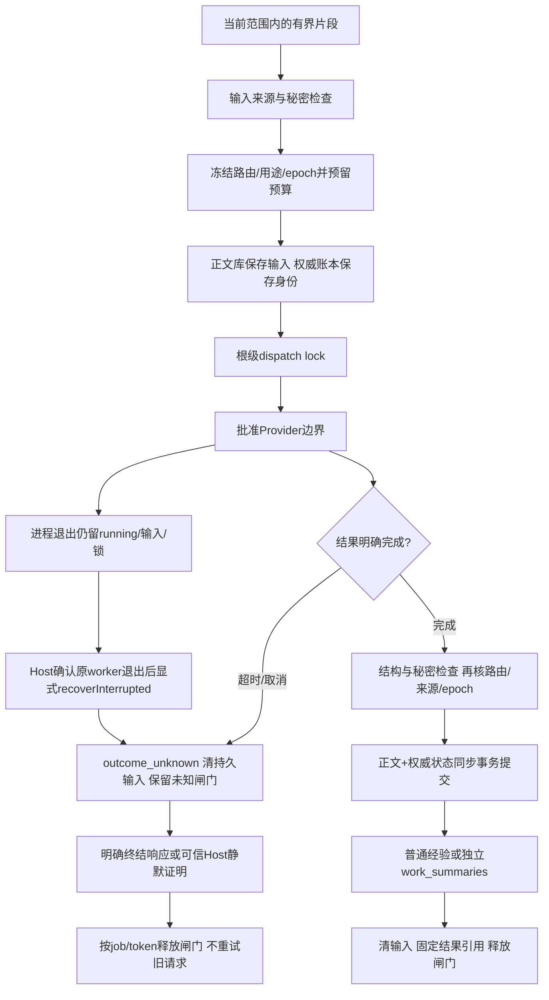

# Task 2机制说明：供后续skill改进使用

日期：2026-11-04。范围仅为已实现的队列、生命周期和工作记录组件。实际Harness桥接、UI、缺证对话提醒、模板映射及年度分页导出留Task 3；本说明不冒充05完整项目的最终机制报告。最终docs/mechanisms.md需合并实际Host旅程后再验收。

## 来源与选择原因

- Task 1固定的kovey 0.3.2独立CJK模块继续提供双字索引与中英文查询表达式；Task 2不加载其整套hook、同步、导入、路由或日志链。
- SQLite提供同步事务、外部内容FTS及索引维护。正文和独立authority以附加数据库、DELETE journal和FULL同步参与同一事务，采用SQLite的[多文件提交机制](https://sqlite.org/atomiccommit.html#_multi_file_commit)；不是跨03/04/05的全局事务，也未做断电/损坏硬件验证。
- 删除索引同时启用FTS5的secure-delete与SQLite core secure_delete，首次启用重建旧索引；仅core设置不足以清FTS旧词条，依据[SQLite FTS5说明](https://sqlite.org/fts5.html#the_secure_delete_configuration_option)及实际影子表/文件字节反例。
- 队列、权威账本、scope、预算、工作记录和断言证据规则由本项目实现，来自既定方案与用户需求；没有接入新记忆框架或托管服务。实际Provider仍由Task 3桥接用户已注册的Harness服务。

## 运行路径

执行次数、结果状态与结果正文是不同事实。job的completed表示当时请求和本地提交完成；恢复旧正文库后，正文可能缺失，但不能因此重发已完成请求。get(job)返回历史结果引用，使用引用前仍需读取当前记录。

## 数据、身份和版本

| 位置/字段 | 含义及使用规则 |
|---|---|
| scope正文SQLite | 经验正文、工作payload、待执行的有界job输入；不是完整原始会话仓库 |
| authority.sqlite | 无正文的记录状态/摘要/来源、scope epoch/revision、事件/操作/请求身份、预算及dispatch lock |
| authority.identity.json | 与权威库对应的固定身份；缺失、不符、损坏或未知schema拒绝开放，不能重建为空清单冒充恢复 |
| store.generation() | scope生命周期epoch；传给队列generation和变更接口expectedGeneration |
| store.revision() | 正文/召回相关变动的单调版本；缓存key和分页cursor绑定它；enqueue、预算、job运行状态等纯队列账本写入不推进它 |
| record/work.generation | 该正文版本的revision，不是scope epoch；不可直接拿它代替expectedGeneration |
| sourceRef/version/fragment | 独立来源身份；版本参与请求与证据去重，默认工作事项ID不随sourceVersion变化 |

Task 3必须分别传递scope epoch与正文revision；不能看到旧UI token后临时读取当前版本替换，以此让过期动作通过。队列总会绑定并重核入队epoch；本地可信手动调用可选择最新状态操作，Host用户预览/确认流程应带原始epoch。

schema 1仅在显式allowLegacyMigration且固定旧结构核对通过后迁移到2。内容表、FTS定义/trigger及权威schema均按受信结构核对，运行中DDL变化或FTS安全删除策略失效也拒绝操作。没有自动下载、切库或宽范围检索降级。

## 决策规则与skill改进接口

| 编号 | 场景、触发与前置条件 | 判断/动作及结果 | 失败、提醒与可调策略 | 代码硬边界/验证 |
|---|---|---|---|---|
| MEM-QUEUE-01 | 当前获准片段需要提炼；可信调用方已给scope/来源和注册routeRef | enqueue冻结路由、用途、epoch、会话和输入摘要，事务预留预算 | skill可选何时提炼、片段和用途；不能扫描历史来补材料 | credentials等来源拒绝，输入最多8000字符，模型不选路径/scope；jobs.test |
| MEM-QUEUE-02 | 一个排队任务准备执行 | 只用冻结provider/model/routeVersion；登记根级独占job/token锁；结果写回前再查路由与epoch | route撤销/改变则失败，不选其他key或CLI；skill应报告不可用 | 全根记忆任务并发1，不等于控制Harness主聊天或其他插件；跨scope锁不可由外scope解锁 |
| MEM-QUEUE-03 | 超时/取消，或Host确认原worker已退出后显式recoverInterrupted | 前两者立即标unknown清持久输入；崩溃当下不执行清理，重开也保留同epoch running/输入/锁，显式恢复后才unknown并清输入；预算不自动退回 | skill停止该任务推理，不盲重试；Task 3启动恢复负责确认worker及逐scope调用；可继续人工本地登记 | 恢复不解闸；原响应明确终结或可信Host证明静默后才释放；旧请求仍不重试；generic拒绝不当作远端已停 |
| MEM-QUEUE-04 | 明确完成的结构化模型结果 | 全部验证后同事务写经验或work集合及完成状态，清输入 | 无结果/非法字段/秘密/提交拒绝都不伪装完成 | output不能改scope/来源/证据认证；晚到结果不写回，raw异常不进返回/日志 |
| MEM-LIFE-01 | 用户删除、更正、归档或来源失效 | 递增epoch，所有旧epoch排队输入统一清理、queued转stale；在途响应仍守锁 | skill解释影响范围；不能承诺撤回Provider已收到的内容 | 删除正文与FTS，保留无正文tombstone；更正supersedes；归档保留正文但停召回 |
| MEM-LIFE-02 | 旧正文快照/整个旧正文库恢复或索引重建 | 现存权威状态优先；官方snapshot restore只收active同版本正文；旧库reconcile会清deleted/superseded/不匹配正文，archived/stale同版本可保留但不召回 | 缺权威账本拒绝开放，不能回退热缓存 | 官方restore不接受账本；旧库内job输入也按当前epoch过滤；lifecycle/migration.test |
| MEM-WORK-01 | 当前对话显式形成项目/需求/探索粗总结 | 独立work_summaries；贡献/结论/结果分别保存basis/support/confirmation，日期也标来源与确认 | 缺结果、日期、材料仍可保存为unknown/待补；skill后续选择提醒时机 | 模型默认inferred/missing/pending，不能认证成果；普通经验召回不读此集合 |
| MEM-WORK-02 | 同一事项出现新来源/新版本或合并候选 | 稳定sourceRef+fragment锚保持事项身份；新版本需明确merge/correct | skill可建议归属，不能按相似标题合并；重复相同候选no-op | 多锚无itemRef拒绝；矛盾保留候选及待确认，已确认时间/贡献不被覆盖 |
| MEM-WORK-03 | 用户登记证明或明确要求核对一条断言 | register只登记引用；review在当前许可下读取有界本地文本并核quote/digest，限定该断言 | 缺失/不支持格式保持未读，不下载URL；可建议更合适的证明 | evidenceRoots、当前authorize、秘密/大小限制、逐claim版本绑定；文件存在或确认不自动等于支持 |
| MEM-WORK-04 | 查询有历史支持的工作记录 | 当前Host grant允许才重新核材料；变更/不可读/撤权降unread | 同范围已有许可只查询本地grant，不逐次弹用户确认；skill显示待重核 | 正文readAuthorized只是历史记录，不是永久读许可；原材料内容不发送模型 |
| MEM-WORK-05 | 未来按年生成依据 | Task 2仅提供独立持久记录/状态与scope内分页读取；正式年度导出/提醒/映射留Task 3 | 具体年终维度未提供，始终pending_reference；不可补评分/收益 | Task 3年度导出必须走当前核对视图，不能把恢复快照中的历史support当当前认证 |

相关实现：[队列](../src/jobs.mjs)、[Provider边界](../src/provider.mjs)、[存储与同步事务](../src/store-internals.mjs)、[生命周期](../src/lifecycle.mjs)、[工作记录](../src/work-summary.mjs)、[有界证明读取](../src/work-summary-evidence.mjs)。

## 预算与未知状态的实际语义

默认每个记忆数据根/上海自然日最多20次请求、80000输入字符、4096预留输出tokens；每个(scope_ref,session_ref)累计最多5次，同一个session跨scope不是一个全局会话计数；单次输出上限默认512 tokens、最大2048。不同记忆用途共享这些计数。它们不是货币估价或整个Harness账户总账单上限；输入字符也不是input tokens。

预留发生在enqueue，同源重放不会再扣。失败、取消、未发出的失效任务也不自动退款，优先保守限制；重启不能清掉预算。跨日旧请求拒绝执行，不能拿昨日预留在新一天排空。结果usage只有结构合法时才标reported；没有实际usage或服务端结果不明仍是unknown，不宣称免费/未计费。

unknown闸门保存job/token。正常终结响应只释放对应token，旧回调不能放开新owner；进程中断后无法凭本地状态确认远端结束。崩溃当下仍为running，持久输入和锁保留；单纯openStore不会转态或清掉同epoch在途输入。Task 3须在确认原worker已退出后对相应scope显式recoverInterrupted，转unknown并清输入，但仍保留锁。confirmRemoteQuiescence需要可信Host当前许可和结束/取消证明引用，默认拒绝；不把任意用户字符串当远端已经停止。后续Host适配必须给实际收据，不能对所有请求返回true。解除闸门不会重试或改写旧unknown请求。

## 证明、日期与冲突

证据读取只支持有界UTF-8文本及已登记本地根；URL只作未取回引用，不请求外部服务。支持是“该材料版本支持这条陈述”，不是对整个项目或人的认证。同一材料用于多个断言时，每个断言分别绑定摘要；重新核对结果不能替别的旧断言刷新证明版本。

authorize是可信Host对现存授权/用户操作收据的同步检查，默认deny。read/review、confirmation、correction与revalidate分别检查；不能直接使用模型输出或正文布尔值作为许可。Task 3负责实际用户交互和可撤销授权，组件测试用边界替身，不证明真实UI许可流程已完成。

模型给出具体日期仍为inferred/pending；observedAt只是记录时间。确认当前日期不代表材料支持已成立。后续来源提出不同日期时，保留已确认原值，把新日期放进time冲突；goal/关联字段的差异也进入候选。相同候选重放不改epoch/revision。显式correct产生新修订并保留来源，不能用最新模型答案抹掉用户确认。

恢复快照保存的是版本化正文/历史核对信息，含at_recorded_version标记。它不是年终报告导出。读取当前支持状态应使用manager.get/list，服从当前授权和材料摘要；Task 3报告导出还须核批准scope集合、未知日期、分页完整性并显示自述/待补证。

## 删除和恢复的范围

删除清理当前SQLite正文、索引及可清的空闲页，回执限定为currentSqliteBodyAndIndexCleared；不是SSD介质擦除，也不删除外部备份、已导出文件或Provider副本。测试验证唯一合成词条既不在查询中，也不在FTS影子块和当前数据库字节中；旧不安全索引及Task 1迁移均验证重建清理。

archive保留正文；forget不可经restoreArchived撤销。正文restore只能恢复当前权威账本仍认定active的同版本内容，不能还原tombstone或预算。管理员同时回滚全部正文、控制库和锚文件不在本层可证明范围内；权威清单丢失/损坏时保持不可用，需要另行审查的恢复材料。

## 证据与未验证边界

正式全套包括源锁、Task 1兼容回归及Task 2真实临时SQLite/FTS、进程退出、超时晚到、并发、恢复、raw索引字节、证据与来源反例。见[Node输出](../evidence/task2-node26.tap)、[内嵌运行时输出](../evidence/task2-host24.tap)及后续独立评审记录。

实际Host服务、批准Provider网络调用、可信授权UI、真实junction、固定盘重新准入、Linux、断电/磁盘故障、语义记忆质量和完整年度导出都未由这些组件测试认证。Task 3必须补这些适用的实际接缝与出口证据，不能据本说明跳过。
