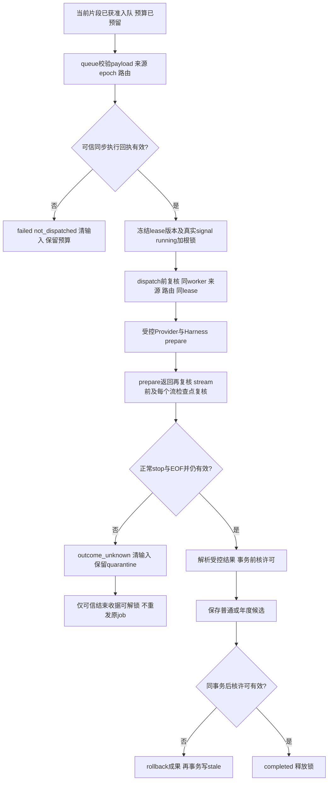

# Task 3阶段机制：作业执行许可与撤权

日期：2026-11-06。用于后续改进skill；仅覆盖queue/Provider执行授权合同。完整`docs/mechanisms.md`仍待整体插件交付。本阶段没有自动scheduler、真实Host许可数据库映射、主模型最终请求投影、UI或年度导出，不能把合成grant测试算成真实认证。

## 来源、入口与旅程

直接复用本项目Task 2的SQLite/FTS事务、持久预算、来源/epoch校验和unknown账本，以及Task 3既有Harness桥接。新增`authorizeExecution`、lease复核和撤销传播为自行实现。真实依赖仍是固定Harness0.2.1-rc.5/build `d4db512a969fccf0c5cc7ec8fe38e9c1d27af916`的LLM/SDK；exe/ASAR摘要由[runner回执](../evidence/task3-execution-host24.json)锁定，没有复制/执行证据目录源码。没有新依赖、外部记忆服务或新增上游源码；kovey固定版本的唯一直接复用仍是原CJK文件。

入口为[createJobQueue](../src/jobs.mjs)配置项`authorizeExecution(metadata)`，默认返回undefined。模型、skill和普通enqueue调用都不能提供该callback。真实Host将来必须把准入来源、精确正文摘要、scope/purpose/route及目标对应到批准记录；看到合法sourceVersion或opaque fingerprint本身不是许可。

## 稳定机制

### MEM-EXEC-01：默认拒绝与固定身份

触发是可信调用方显式调用`runJob`；hook仍只enqueue，不自动执行。既有预算日/策略、epoch、payload完整性、输入计数、来源和批准路由检查先执行，再捕获授权。`authorizeExecution`接收冻结对象，route也冻结：

`phase/jobId/scopeRef/payloadFingerprint/purpose/sessionRef/sourceRef/sourceVersion/fragmentRef/inputClass/inputDigest/generation/route/itemRef`。

输入正文和inputRef不提供给授权callback。payloadFingerprint是已存payload的摘要，inputDigest是实际准备发送的字符串摘要；显式itemRef供年度merge目标授权。phase只描述claim/dispatch/commit/commit-complete，同一运行的其余身份不变。

回执严格为`{authorizationVersion,signal}`，非空版本和原生signal品牌校验都必须通过；true、缺字段、伪原型对象、throw、Promise均拒绝，Promise的reject被观察。raw错误不进返回状态；claim及首个dispatch复核失败为`execution_authorization_unavailable`，后续阶段按EXEC-03/04分类。未执行时拒绝清持久输入、保留已预留预算、不调用Provider，不回退其他模型。callback自身不得执行网络/读取未经许可材料；这里是可信Host接口，并非通用JS沙箱。

本阶段不改schema/payload；授权并非随enqueue永久保存的allow标志。已有queued在缺当前真实许可时同样失败；将来可信Host可对精确同jobId/fingerprint明确批准。不能自动给旧任务补许可或换身份续跑。

授权及路由回调必须只读可信状态，不得在回调内重入队列恢复、删除等生命周期写操作。后置检查可防部分误重入覆盖旧worker，但同事务内的误写也会随拒绝rollback，不能把它当可靠的删除执行入口或任意JS副作用沙箱。

### MEM-EXEC-02：一次lease与持续撤销

claim捕获一次版本和signal。后续回执对象可新建，但版本及signal对象必须相同，signal不能abort。deny、异常、Promise、版本漂移、signal替换或abort使本次lease黏性失效，之后即使换新grant也不能继续旧运行。

signal状态用捕获的原生`AbortSignal.prototype.aborted` getter读取和验品牌，避免`Object.create(AbortSignal.prototype)`加自有`aborted:false`伪装。真正撤权服务必须abort旧signal：只改版本不能唤醒悬挂prepare/next，只能在下一检查点或timeout拒绝。用户signal、授权signal及timeout共同取消本地等待并请求Provider取消；都不证明远端已经停止。

代价：撤权后同一旧job不能恢复或自动重发；需要新需求、新授权与预算决策。skill可解释queued/unknown和建议核对授权，不能生成新signal替换旧许可或自动解除unknown。

### MEM-EXEC-03：覆盖prepare的异步窗口

queue在execute前复核，向[controlled Provider](../src/provider.mjs)透传同步`assertExecution`；该函数核本次lease、signal、当前job仍running且run_token一致、epoch、sources与完整批准路由。它在Provider invoke之前调用，并由[Harness桥接](../plugin/harness-provider.mjs)各checkpoint调用：准备消息前、prepare前/后、stream前、每次next前/后，以及公开完成边界。

这使forget、source失效或worker恢复发生在prepare等待期间时，prepare返回后不能继续发送该输入。代码不以仅有来源版本检查替代用户许可，也不以用户许可替代来源/代次校验。

queue明确尚未调用execute时可failed/not_dispatched。controlled Provider在invoke前拒绝可RouteUnavailable；一旦Harness触碰prepare，失败可能已有metadata访问，后续guard异常只能generic unknown。不得把后置guard的RouteUnavailable原样传出而误报零dispatch。Provider同步throw通过Promise链捕获，与异步未知异常一致，不遗留未观察timer拒绝。

边界：检查约束本项目queue/bridge调用接缝，不能证明任意adapter内部没有重试/额外出口。当前是记忆提炼请求，不能据此宣称主对话请求的最终projection/dispatch已补齐；上一阶段MEM-HOOK-WINDOW-01仍有该缺口。

### MEM-EXEC-04：成果事务前后检查

成功完整返回后先解析并验证普通或年度schema。保存时在同一个同步`write`中：检查lease、worker token及原来源/epoch/route和取消 → 写records或work_summaries → 同样再检查 → completed。最后外部授权/路由回调之后再核内部不变量；也直接读原runJob signal，避免流等待listener已移除后漏掉调用方取消。后核拒绝必须抛出事务外，随后另开事务写stale并清输入。这样结果、权威条目、年度操作记录不因“只核写入前”而残留。

已正常完成响应但提交许可失效返回stale，费用保留reported或unknown，可释放该次锁；它有完整响应，和执行不明分开。模型输出只能成为原有未核验经验/工作草稿，不改变scope、权限、证据support或用户确认。年度维度仍独立，不进入普通召回；《年终总结维度.md》尚未提供，模板映射、缺证提醒/证明文档对话、正式导出仍待实现。

年度merge有合法的scope epoch递增。事务写入前必须符合原claim epoch；受控本地成果写入完成后、调用最终Host回调之前捕获writtenEpoch，后核以它为期望值，防止将自己的merge判成失效，也能拒绝最终回调期间新的代次变化。授权metadata仍描述原始固定任务，不能随写入换身份。后核撤权则把merge的候选、sources/conflicts及这次epoch递增一并rollback，保留原年度条目；正常merge不替换既有本人贡献，只增加未确认冲突。

### MEM-EXEC-05：unknown不因晚到settle自动解闸

本阶段有意收紧旧行为：移除`releaseAfterSettled`，不再按`confirmedSettled`竞态决定unknown是否保留锁。执行可能已开始后的abort/timeout/非明确终结错误，一律outcome_unknown/unknown并保留quarantine；晚到success/reject不会提交成果，也不会放行第二个任务。

只有既有`confirmRemoteQuiescence`通过可信`authorizeRecovery`确认remote_finished或remote_cancel_confirmed后可释放；原job仍unknown，不重试。真实结束收据接入尚未实现，合成测试中的固定true只为测试该既有恢复合同，不能用于生产。预算不退款，实际账单仍需Provider凭证。

| 可观察终态 | 费用标记 | 输入/成果 | 根级执行锁 |
|---|---|---|---|
| failed，queue自证尚未execute | not_dispatched | 清输入、无新增成果 | 不保留 |
| outcome_unknown | unknown | 清输入、晚到不提交 | 保留直到可信确认 |
| failed，完整响应但schema非法 | reported/unknown | 清输入、无成果 | 释放 |
| stale，正常完成后许可/来源失效 | reported/unknown | rollback成果、清输入 | 释放 |
| completed | reported/unknown | 保留受控候选、清输入 | 释放 |

以上所有状态保留预算预留。旧[Task 2机制](task2-mechanisms.md)及[Provider阶段](task3-provider-mechanisms.md)为历史快照，unknown自动解锁描述以本阶段规则为准；旧证据不改写为新行为。

## skill改进接口与最小验证

| 稳定编号 | 可由skill调整的策略 | 必须由plugin/Host执行 | 最小验证 |
|---|---|---|---|
| EXEC-01 | 建议提炼时机、解释拒绝、询问需不需要重新批准 | 同job/scope/inputDigest/purpose/route/目标许可，默认拒绝 | queued后撤权：零prepare/stream，清输入、不退款 |
| EXEC-02 | 告知取消的实际边界、建议核对新授权 | 原生signal、同lease版本/身份、黏性失效 | 旧signal abort后换新grant，旧job仍unknown |
| EXEC-03 | 建议缩小片段或等待配置稳定 | 不能以prompt绕过prepare后的guard | prepare阻塞中撤权/forget，之后零stream |
| EXEC-04 | 呈现候选和证明缺口，要求开发者复核 | 事务前后检查、schema/独立年度集合、support不提升 | 写入后拒绝：普通与年度集合/操作结果均无新增 |
| EXEC-05 | 明确unknown待核、不自动再试 | 根锁、可信远端结束证明、不重发旧任务 | 晚到success后第二job仍gate-held，显式可信确认才放行 |

后续改skill记录需引用完整`MEM-EXEC-*`编号及相应用例。调整限额/提示词并不改变授权与网络边界。待验证假设包括真实许可DB能否在不读取额外正文的前提下可靠绑定准入与job，以及可信scheduler如何与scope关闭/重启恢复协作；这些不是本阶段已认证能力。

## 证据范围

[新授权单元](../tests/execution-authorization.test.mjs)13项，使用真实SQLite/持久queue；[桥接单元](../tests/harness-provider.test.mjs)新增2项prepare窗口反例；[原生执行测试](../tools/host-api/execution.test.mjs)5项使用实际安装库Context/LLM/SDK和临时资源，但adapter及grant为合成替身。旧queue相关测试显式添加`authorizeTestExecution`，默认拒绝测试直接使用真实createJobQueue，无测试全局默认放行。

主回归Node125项、内嵌Host146项的最终结果、独立结论及摘要以[阶段报告](task3-execution-review.md)和[物料清单](../evidence/task3-execution-verification.json)为准，未完成的验证不得用本说明预告代替。网络守卫空列表只覆盖指定Node网络API，非整个Host/Chromium/原生模块/子进程出口证明。没有真实profile、凭据或业务模型API访问；该声明基于测试调用路径，不是OS级监测。
