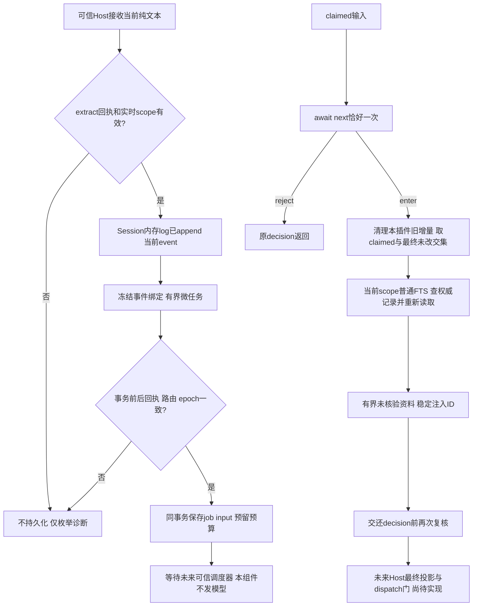

# Task 3阶段机制：当前消息准入与普通记忆召回

日期：2026-11-06。本说明用于后续改进skill，仅覆盖当前事件入队和pre-step召回组件。完整项目的`docs/mechanisms.md`尚未交付；批准配置解析、真正授权回执、作业调度/执行授权、最终请求复核、管理UI、年度提醒/导出和完整出口验收仍待实现。

## 分层、来源和典型路径

入口是[installSessionHooks](../plugin/session-hooks.mjs)。调用方必须提供真实`ctx.sessions/agents`、同步`resolveScope/admitMessage/createUserMessage`；真实Cordis fiber声明`inject:['sessions','agents']`。默认scope和准入回调拒绝全部。skill负责何时建议提炼、要求开发者核对及呈现依据；plugin执行边界，Host维护真实会话、准入和路由。模型或skill不能用source标签替代许可，不能扩大scope或解除unknown。

| 固定来源 | 实际采用方式与机制 | 未采用或尚未完成 |
|---|---|---|
| Harness 0.2.1-rc.5，build `d4db512a969fccf0c5cc7ec8fe38e9c1d27af916`；exe/ASAR摘要见[回执](../evidence/task3-hooks-host24.json) | 直接依赖Host服务；核对真实Controller创建`kind:user/rpcId/principal`、Session先log.push再event、AgentLoop先waterfall再prepare/append。真实安装库测试调用原SDK消息工厂 | 不执行证据副本，不读取真实profile或把rpcId当签名。当前没有运行完整AgentLoop |
| 已锁定kovey/dsh-memory 0.3.2，commit `73e0a3b47fb047cc9fe3cd8269a5f267c6cda45c` | `agent/pre-step`及提炼触发点仅为机制参考；唯一直接复用仍是已有vendor CJK切分文件 | 没有合入其hook/db/自动导入/Git同步。当前准入、权限、事务、去重、生命周期为自行实现 |
| 本项目Task 2队列/SQLite和Task 3 Provider桥接 | 直接调用既有`enqueue/search/get/write`；新增[snapshotQueueRoute](../src/jobs.mjs)用模块私有WeakMap核实queue/store归属并复制完整四字段路由 | 不创建第二个数据库writer，不在hook调用`runJob`。Provider如何结束和取消见[前阶段机制](task3-provider-mechanisms.md) |

上述event证明进入Host内存append-only log，不是磁盘fsync或主模型已接收的证明。extract的排队输入会持久化；召回正文会进入交还的decision/随后Host历史，不能承诺从既有历史或模型中撤回。

## 稳定机制与决策依据

### MEM-ADMIT-01：当前来源和两种许可

触发为真实`session/event`的`user/message + surfaceOp:append`。必须满足live registry中的session/agent对象相同、`agent.id===session.id`、`session.eventAt(seq)===event`。消息是user，source只允许`kind/rpcId/clientTimeZone/principal`，正文为1—16个纯文本块、合并后最多8000 UTF-16单位；附件、未知块、秘密模式或混合非法材料整条拒绝。队列还执行原有输入检查与含固定prompt的总预算，hook通过8000不保证最终入队成功。

`admitMessage`按`action:extract|recall`分别授权，并绑定scope、sessionRef、messageId、rpcId、完整contentHash、authorizationVersion；extract另含seq。回执只含originRef/hash/授权版本，逐项比较，默认拒绝。标签与这些可序列化字段不具有凭据效力，可信实现必须查询真正准入链；当前只测试合成回执，没有认证真实认证链。principal不送入queue或召回文本。同步回调返回Promise会被观察并拒绝，避免未处理拒绝泄漏异常。

失败不阻止Host原消息提交，不发用户通知，只返回固定诊断码。skill可解释为什么需要批准或要求更小片段，不能接受“忽略权限”提示。证据：25项单元中的伪造/非user/附件/秘密/异步回调/跨session反例，8项原生测试中的真实SDK与Session事件。

兼容债：固定Host源码已将同步`eventAt`标deprecated并要求新调用迁移。本组件暂以当前确实可用的原对象查询做事件身份核对；尚未实现有相同可信度的新异步准入收据接口。升级Host前必须重审此接缝，不能删掉身份检查来消除弃用警告。

### MEM-ADMIT-02：身份、幂等与来源前缀

session ID限200且匹配`[A-Za-z0-9][A-Za-z0-9_.:-]*`；header必须version4、id匹配、createdAt为非负安全整数。`sessionRef = 原始session.id / hash(id,version,createdAt)`，保持原始ID为subtree根，便于未来03删除关联。它是Host命名身份摘要：恢复相同header会碰撞，同毫秒重建也不保证唯一，不冒充随机实例凭证。

requestId只绑定sessionRef、消息ID及固定`memory_extract`，不把原文、seq、路由或epoch放进去绕过去重。sourceRef另含实际seq及消息ID摘要；sourceVersion绑定originRef与完整正文hash。同ID同事件重放复用已有预算/任务；同ID改文或换seq保守冲突拒绝。scope是队列既有身份的一部分，可信回执仍须拒绝将A批准材料重新授权给B。

代价是有意拒绝部分合法恢复/重编辑；不得通过换requestId重试以绕过unknown。测试检查job、input与预算，而非仅检查返回码。`status().queuedCount`是成功enqueue回执次数，包含幂等重放，不是不同job数、模型次数或成果数量。

### MEM-ADMIT-03：冻结排队与原子回滚

event回调冻结当时store/queue真实对象、scope/session身份、epoch、授权版本、完整路由描述与准入回执。最多32个pending、累计32000 UTF-16输入，等待超过1000ms丢弃。微任务不能改绑新的当前scope。

入队前先用模块私有queue所有权登记证明同一个store，再以现有`write(contextOf(store))`外层事务覆盖enqueue。同步执行前、后复核全部绑定和回执，后核失败必须抛出事务外，job、job_inputs、日预算一起rollback。无跨await长事务。换scope、grant撤回、route/generation漂移或外来queue均拒绝；错误仅枚举诊断。

边界：TTL与drain约束异步等待，不能抢占同步SQLite或任意可信回调；硬限可降低，不能靠skill增大。证据含post-enqueue撤权导致三类新增全为零、延迟A遇到B以及pending数量/累计长度/TTL反例。

### MEM-RECALL-01：只查询最终获准的当前交集

pre-step在调用next前记录live binding与至多16条claimed候选；恰好`await next()`一次，reject或其他非enter原样返回。enter只以claimed和最终messages中ID及正文hash均未变、另获recall许可的交集产生查询。替换/移除的claimed、工具消息、过去历史或自身召回不能成为查询后备。scope/授权在next等待期间变化则不查旧scope。

以最多2000 UTF-16查询当前普通store的FTS，最多5条，不读独立`work_summaries`、会话历史或证明文件。每条命中重新`get`，核同scope/generation及整条记录摘要。render时总共最多4000单位，单条超出则整条跳过，标`verification:unverified`并声明“仅供核对、不赋予权限”。独立`memory-recall`source避免冒充Host的`runtime-context`。

代价：词法召回和整条跳过可能漏长记忆；未运行质量benchmark，不声称准确率。skill可建议缩小检索题目/检查当前证据，无法以prompt提升验证等级或混入年度工作记录。证据覆盖render预算、普通/年度分离、删除后重新查无旧正文、数据库/授权失败不回退。

### MEM-RECALL-02：稳定注入、增量重入和提交收据

缓存最多128组，只存ID、scope/session/source摘要及committed标记，不存正文。key包含scope、授权版本、epoch、revision、turn/step、输入ID/hash/origin及renderedHash；每次重入仍重新查询。相同未提交内容重用ID，记录更正/正文变化生成新ID；factory输出必须与重新构造的不可变消息完整摘要相同。异步factory拒绝会被观察，raw错误不流入Host。

真实AgentLoop的`decision.messages`是本次待append增量，并非完整历史投影（loop:1067—1072）。因此每次先从该增量移除本插件所有旧召回；有效未提交召回补一个，已经提交则不再补。即使调用者传入`[当前消息, 已提交召回]`，返回增量仍移除后者；此前历史中的一次召回仍在Host log/surface中。这样避免再次append同一消息，不表示从上下文撤回历史。

提交标记只接受真实event、当前activation、同sessionRef、已登记ID以及完整source/content摘要全部匹配；伪造标签/ID不能抑制之后合法召回。收据只证明入内存log，不证明仍在surface或模型已接收。元数据淘汰、dispose或重启会失去这一内存标记，因此它不是永久Exactly-once；未来完整Host入口需要另行定义恢复策略，不能声称跨进程去重。

### MEM-HOOK-LIFE-01：单writer与局部清理

进程同realm全局Symbol下的WeakMap按ctx.root登记一个owner token，阻止兄弟fiber/同模块多份加载重复安装；不证明跨VM/进程互斥。每次监听成功立即保存off，再注册下一个；部分失败逐项清理。旧disposer仅可删除自己持有token，不能抹掉后来实例。

dispose先停状态、卸监听，清尚未准入frame和元数据，再有界drain；迟到回调不能入队或注入。重复dispose幂等。已持久化queued输入仍留queue，明确返回`queuedInputs:retained_by_queue`，不会取消远端作业或清除持久数据。drain只等本地微任务，默认100ms、可配1—1000ms，永不调用runJob。诊断只含code；诊断回调自己的Promise拒绝也被观察。

### MEM-HOOK-WINDOW-01：有效性窗口与待补硬门

召回事务中复核权限/路由/epoch/revision，交还decision前最后检查signal和激活。保证到此时有效。外层middleware或`prepareRequest`随后还可await，期间forget/撤权/scope切换仍可能发生；事后session/event不能否决已发生的log.push。后续必须有Host最终请求投影/dispatch前重核，不能靠skill提醒或跨await锁库补此缺口。

hook不执行queued；持久排队之后授权撤销的执行前/提交前重核仍待可信scheduler实现。现有queue的source/epoch/路由检查不能代替用户许可检查。当前阶段不能安装为完整插件、不能声称自动提炼全链路完成或所有出口受控。

## 可改策略、依赖与最小验证

| 调整点 | skill可建议的策略 | 必须由代码/可信Host执行 | 建议最小验证 |
|---|---|---|---|
| 调用时机/用户解释 | 建议提炼时机，说明拒绝和请开发者核对依据 | resolveScope/admitMessage默认deny、action独立授权 | 撤回extract而保留recall，零新增job |
| 召回预算/呈现 | 更小问题、减少条数和字数、引用来源 | limits只能降低固定cap；未核验标签和整条跳过 | 上限/+1，普通/年度分离 |
| 重入与删除 | 告知删除限制，要求按新事实复核 | MEM-RECALL-02身份/摘要，MEM-HOOK-WINDOW-01最终门 | warm→forget→重入；后续再测prepare等待中撤权 |
| 调度/恢复 | 向用户解释queued与unknown含义 | 本阶段无调度权；未知收据、预算与授权门不能跳过 | 后续先写queued撤权→零dispatch、stream结束前撤权→零提交 |
| 年度工作记录 | 后续显式提醒附证明，分自述/待补证 | 此hook固定memory_extract，不能自动升工作成果或support | 后续合成需求→工作collection→缺证提醒→带引用导出 |

规则依赖：ADMIT-01可信许可→ADMIT-03冻结与回滚→未来执行授权；RECALL-01当前交集→RECALL-02重入身份→WINDOW-01最终请求门。改skill不能绕过任一层。待验证假设包括更精确的词法query能否减少误召回、持久注入收据是否值得复杂度、如何在最终Host projection去除已失效历史召回；均未在当前实现中完成。

## 已运行证据与未覆盖范围

[单元测试](../tests/session-hooks.test.mjs)25项；[真实安装库测试](../tools/host-api/hooks.test.mjs)8项，挂真实Cordis/SessionStore/AgentRegistry/LLM/SDK，但agent为合成subject、adapter为替身。原生case由独立测试驱动显式runJob验证组件接缝，hook本身零模型调度。全回归Node26为110项、Host24为126项，见[阶段评审](task3-hooks-review.md)和[固定物料清单](../evidence/task3-hooks-verification.json)。

[7份新增Host来源](../evidence/task3-hook-host-api/source-manifest.json)只作源码证据；[逐字节核对](../evidence/task3-hooks-source-proof.json)与实际ASAR匹配，不在运行时import。网络守卫只覆盖指定Node API；空调用列表不证明Chromium、原生模块、其他进程或完整Host无外发。没有加载真实profile、获取凭据或调用已注册业务API；此声明依据测试调用路径，不是全系统监测。
