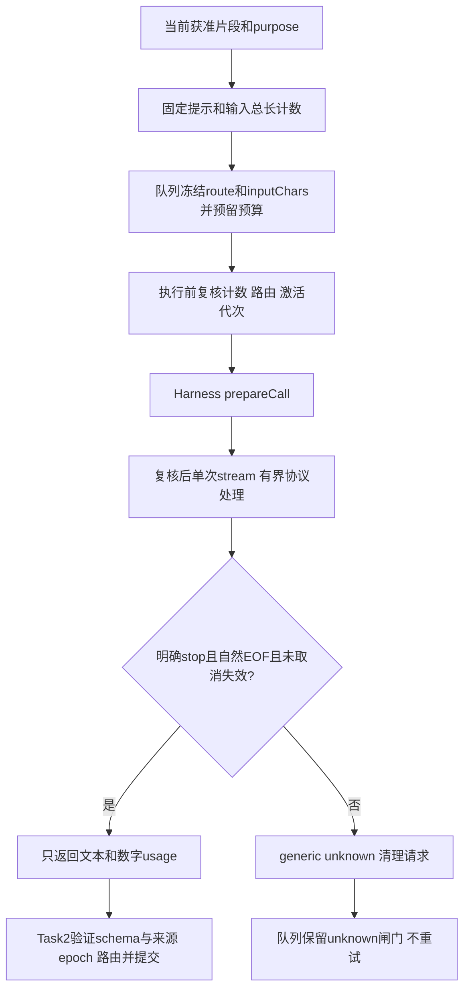

# Task 3阶段机制：Harness Provider桥接

日期：2026-11-05。用途是供后续改进skill及继续原生集成；本说明只覆盖Provider桥接和输入计数增量。完整项目docs/mechanisms.md仍待钩子、管理UI、证明授权、提醒、年度导出与真实Host/出口完成，不以本文件替代。范围、设计分工及来源见[实施约定](task3-provider-plan.md)。

## 来源和入口

实际调用已锁定Harness 0.2.1-rc.5的ctx.llm.prepareCall/stream及SDK消息工厂/BlockAssembler；通过注入SDK和ctx避免复制Host，也不执行证据目录副本。Task 2的createControlledProvider、queue、SQLite和unknown锁继续使用；仅jobs新增可信measureInput合同。钩子与Host行为依据[已独立核对的接口](task3-host-interfaces.md)。无新增运行依赖、网络客户端或托管服务。

入口为[createHarnessProviderBridge](../plugin/harness-provider.mjs)，返回provider/dispose/status。实际Cordis调用方须声明inject:['llm']；测试初次因遗漏inject被宿主拒绝，修正后使用真实fiber验证。readApprovedRoute是尚待完整Host入口实现的同步本地许可/配置解析边界，必须返回四字段routeRef/provider/model/routeVersion；不能把任意已注册Provider或模型输出当批准路由。当前测试仅注入合成版本，不读取真实设置或key。

## 运行路径和决策

| 稳定编号 | 场景→判断→工具动作/状态 | skill可调策略与代码硬边界 | 失败/恢复与验证 |
|---|---|---|---|
| HP-ACT-01 | 初次激活先订阅四类事件，后读取批准描述符；外部routeVersion包含内部随机activation nonce及许可版本摘要 | skill可建议何时重新激活；不能给旧queued换新版本。每个实例的批准路由最多64个 | 任一注册/loader/settings/config-reload事件使激活持续失效并请求取消，即使字段变回原值也不复活；重启旧版本不续跑 |
| HP-ROUTE-01 | prepare前、prepare返回后、dispatch前、结束返回前复核同一四字段与取消状态；有基线后发现描述符不同也失效 | 模型不得选择端点/密钥；readApprovedRoute必须由可信Host解析。缺失/Promise/异常均拒绝 | 事件覆盖不证明无通知的环境或adapter内部变化；真正配置版本解析器及负向wire验收仍待实现 |
| HP-IN-01 | measureInput计算固定system+实际user文本；queue入队冻结inputChars/hash，执行前重测一致 | 单次硬上限8000个JS UTF-16 code units，含实际转发空白；同一prompt常量用于计数与messages | 无hook的旧raw-input provider只计原始input，真实Harness桥接必须带hook；非法meter不扣预算，旧payload缺字段拒绝且不补算/重发 |
| HP-CALL-01 | 每次调用只构造一个system消息和一个当前user片段，来源标识memory-extraction；一个prepare和一个prepared.stream入口 | purpose固定为普通经验提炼/工作提炼/工作合并候选；不加历史、证明正文、工具或其他会话。提示词是候选约束，不是权限机制 | SDK错误或中间件行为不能改queue权限；此处调用次数不是完整wire次数，prepare可能访问metadata，实际adapter/其他中间件仍须审 |
| HP-END-01 | 逐片段记录明确stop，再等待自然EOF；不能读assembler.finish默认值来推断完成 | 最多8192片段、32个块、索引0..1023、累计text/reasoning等字符串64000 units；只接受text/reasoning、usage和唯一终结 | 缺finish、stop后悬挂/异常/重复片段、矛盾块生命周期、tool-call、max-tokens/error/aborted均unknown；测试含真实Runtime本地合成error |
| HP-OUT-01 | 成功终结后只组合文本块，投影inputTokens/outputTokens；reasoning、replay和raw异常不返回 | 文本及JSON/schema仍由现有Provider/queue检验，模型输出不能赋予来源/scope/support/确认 | 成功终结后的秘密/schema非法可以判“结束但结果无效”；无usage仍费用unknown；数字usage不等于账单凭证 |
| HP-ERR-01 | prepareCall调用前的纯本地拒绝可RouteUnavailable；一旦触碰prepare，失败只给generic unknown | 不把SDK抛出的RouteUnavailable或本地error finish冒充无dispatch；桥接不直接动根级锁、不调用恢复授权 | raw异常/Provider错误细节不进返回或日志；不fallback、不盲重试。metadata/服务器处理是否结束不能靠本地异常推断 |
| HP-CANCEL-01 | 父signal、失效、dispose均请求取消；公开完成边界前持续标记后，晚到stop+EOF仍被忽略 | pump/race与外层受控Provider两次await之后各复核，最后一次同步检查定义公开完成边界；之后取消不追溯已完成结果。最多一个pending next，return最多一次 | queue保持unknown且不接受取消前未完成调用的晚到写回/自动解闸。此适配比裸替身Provider更保守，未来需实际结束收据才能恢复 |
| HP-DISPOSE-01 | dispose摘监听、请求取消并有界等待pump/return，之后报告pendingCleanup/cleanupIssues | 默认100ms，可配1..1000ms；重复dispose不重复关流，旧激活回调不影响新实例 | pending next/return可永不完成；返回remoteStopConfirmed=false，不把清理超时/iterator关闭当远端停止。status中的activeCalls包括未完成清理 |

## 预算、版本与升级的实际含义

日输入额度仍由同根queue统一维护，普通与工作用途共享。新计数包含固定prompt与user文本的UTF-16长度，不是token数、货币上限或Provider/middleware自行追加上下文的全量计数。实际请求仍不得绕过已批准模型API；本组件没有网络放行能力，真实Host配置/出口策略后续验收。

inputChars在入队payload和摘要中固定；重复同request不二次扣预算。meter变化、非法值或缺旧字段拒绝执行并清输入，失败不退款。该payload合同无需改SQLite表，但旧排队任务不能透明续跑；completed/outcome_unknown身份和独立权威账本保持不变。旧Task 2报告是历史快照，当前jobs需要本阶段新摘要和评审。

激活fence有意扩大失效范围：不相关settings事件也可能停用当前实例；重新激活需要可信Host重新读批准配置。当前不尝试优化为部分namespace放行，也不自动重新绑定旧请求。稳定跨重启路由续跑、无通知配置变化的检测和恢复交互仍是待验证的改进假设，不能单改skill绕过。

## 阶段验证和限制

测试入口：[Node组件用例](../tests/harness-provider.test.mjs)、[实际安装库用例](../tools/host-api/provider.test.mjs)、[内嵌运行器](../tools/test-harness-provider.mjs)。组件反例使用真实临时SQLite和有限替身；原生用例使用真正Context/LLM/SDK/fiber及假adapter，不加载用户profile或真实Provider。审计网络守卫只覆盖指定Node API，不是OS/子进程/Chromium出口保证。

本阶段不证明模型语义质量、真实前端来源白名单、完整scope解析、真实批准路由/可撤销grant/远端结束收据、自动提炼召回钩子、管理UI、缺证提醒或正式年度完整导出。完整插件尚不可安装；最终测试数量、问题关闭和固定物料见[阶段复审报告](task3-provider-review.md)。
